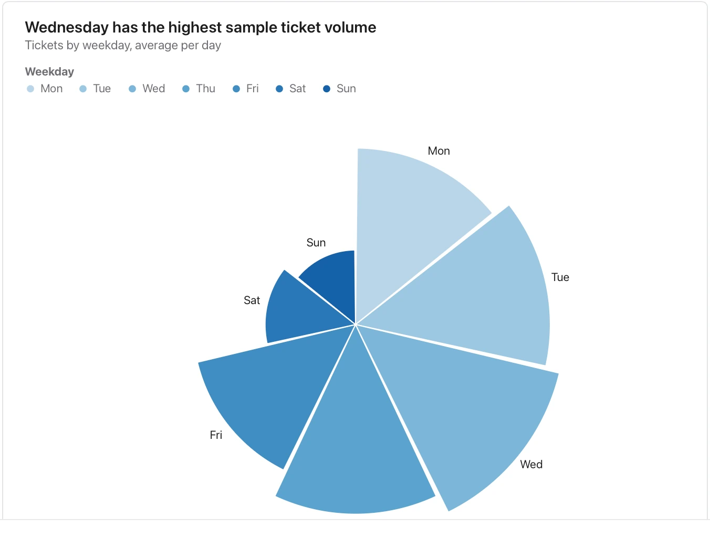

Explain the period and magnitude; radius and area can give different visual impressions, so keep the underlying values available.

**Takes:** a table of cyclical categories and a magnitude, such as hours of the day, months or compass directions, where a polar layout shows the cycle.

