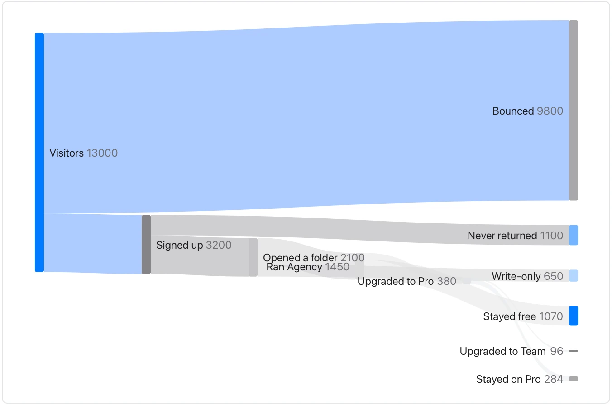

Check units and flow conservation; these numbers are embedded in the diagram and do not update from a source table.

**Takes:** a table of source, target and amount. It shows where traffic, money or people flow from one stage to the next, such as a funnel or an energy balance.

