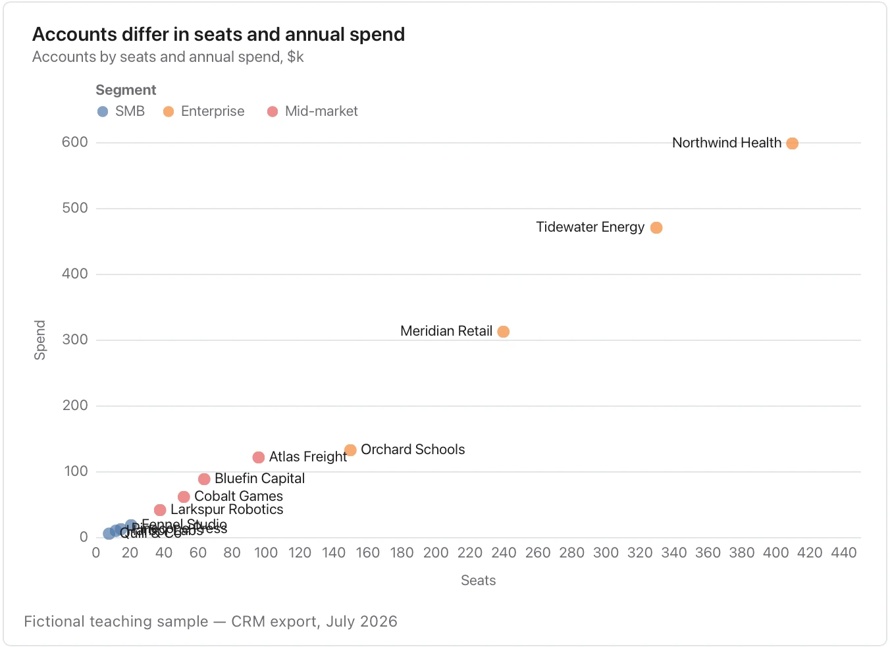

Label both units and investigate outliers; association does not establish cause.

**Takes:** a table with two numeric columns per row, and optionally a category and a size, such as accounts by seats and spend or models by latency and quality.

