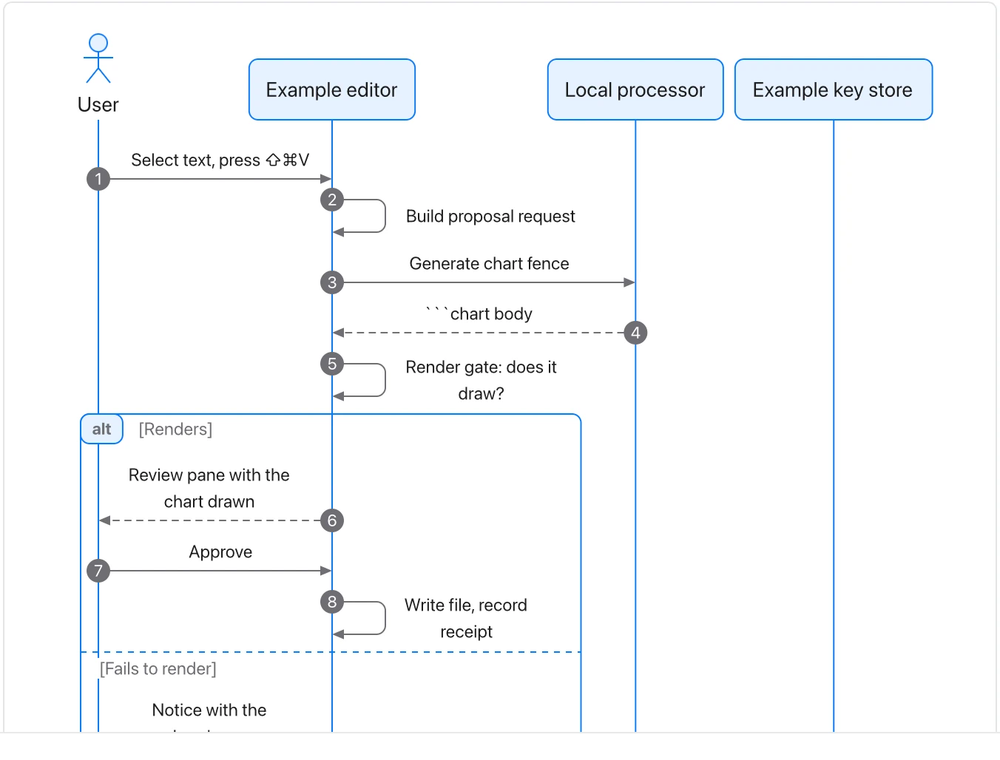

Name the boundary and failure path; the diagram is a scenario, not a trace captured from a live system.

**Takes:** prose or a list describing who sends what to whom, in order, such as an integration, a support escalation or an approval exchange between people or systems.

