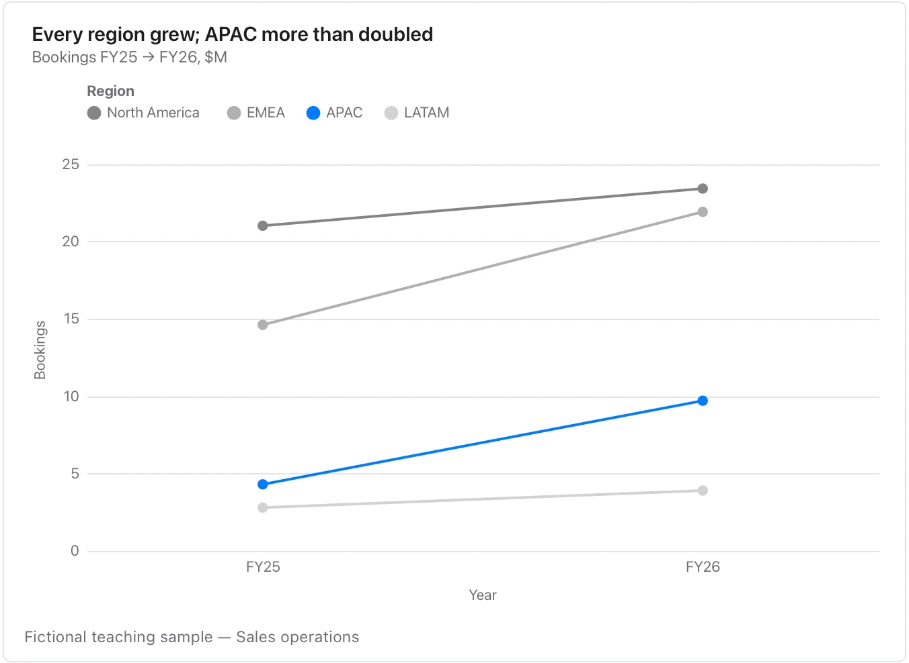

The gap and direction matter; it cannot show the path or volatility between endpoints.

**Takes:** a table with exactly two time points per item, such as before and after or this year and last, where the steepness of each line is the finding.

