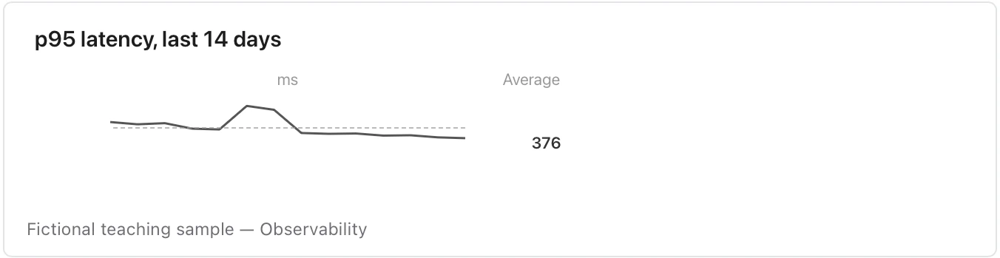

Keep the unit, period and scale context in the title or nearby text because the display is deliberately small.

**Takes:** a short date-and-value table meant to sit beside a sentence, such as a week of latency or a month of signups, shown without axes as a glance.

