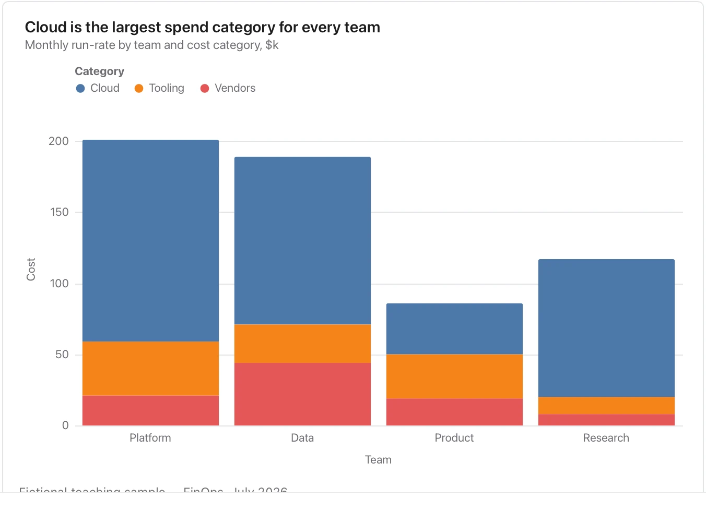

Only the first component has a common baseline, so use grouped bars when precise middle-component comparisons matter.

**Takes:** a table with a category column, a part column and a value column, where the parts of each category add up to a meaningful whole: cost by team and category, headcount by office and function.

