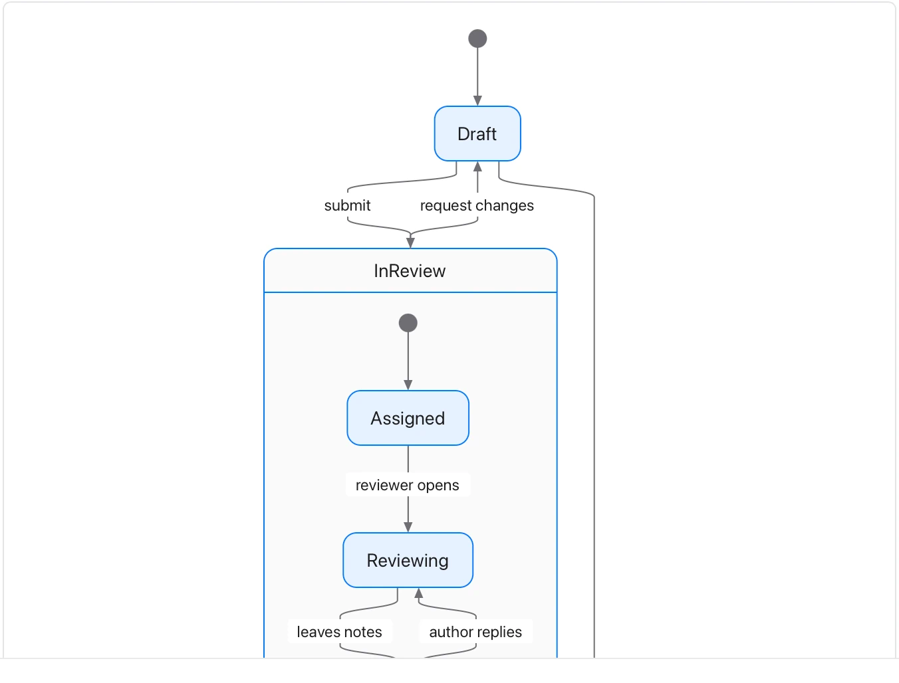

Keep state names distinct from actions and account for endings or reversals.

**Takes:** a list of states and the events that move between them, such as a document lifecycle, an order status or a subscription.

