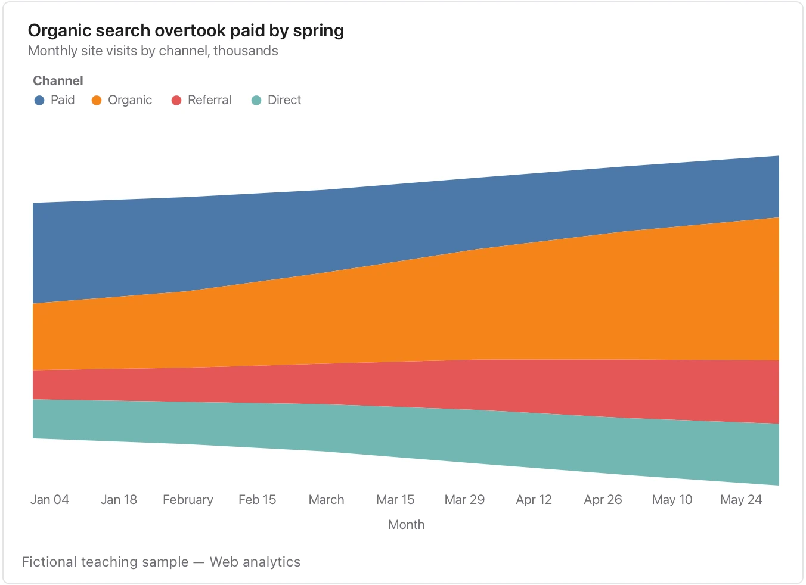

The moving baseline helps show the mix but makes exact cross-period values harder to compare; use lines when precision is the priority.

**Takes:** a long table of date, category and value with several categories per date, such as share of attention, traffic by channel or tickets by product, when the story is how the mix shifts.

