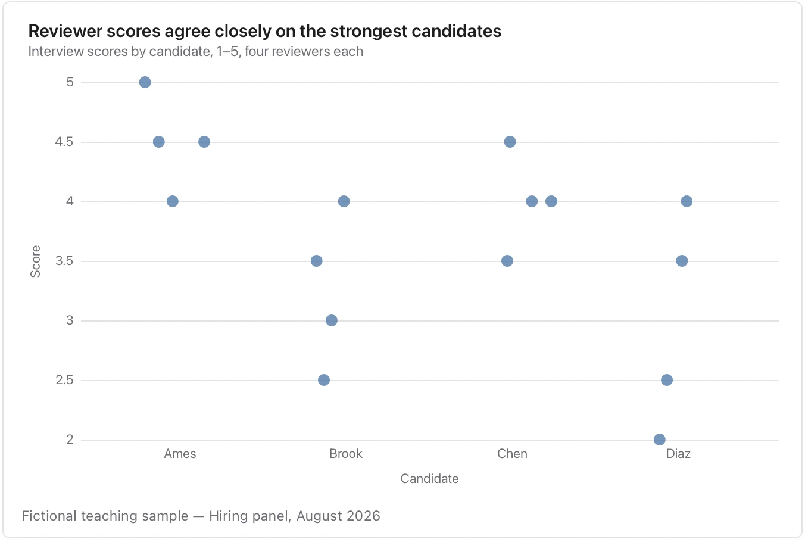

Repeated values may overlap; check the count and use the source table when exact individual values matter.

**Takes:** a category column and a numeric column with a modest number of rows per category, when every individual point should stay visible.

