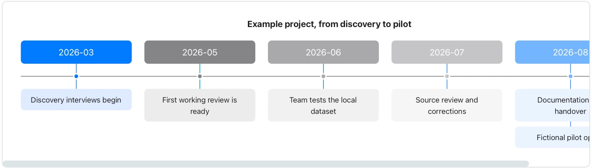

Distinguish planned dates from observed events and do not treat this fictional history as a Flow release record.

**Takes:** a list of dated events, such as a company history, a release log or an incident's sequence.

