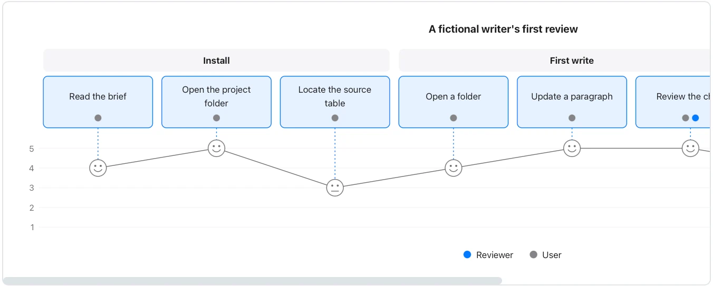

Say whose experience the ratings describe; this sample is not a user-research result.

**Takes:** a walkthrough of what a person does, step by step, with how each step felt: research synthesis, a support transcript, an onboarding review.

