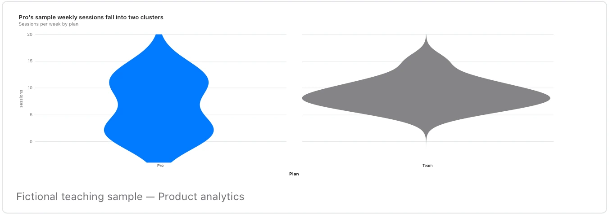

Check sample size and smoothing; a suggestive shape is not evidence for a user persona.

**Takes:** the same category-and-value table as a boxplot, when the shape of each distribution, such as bimodal or skewed, is the point.

