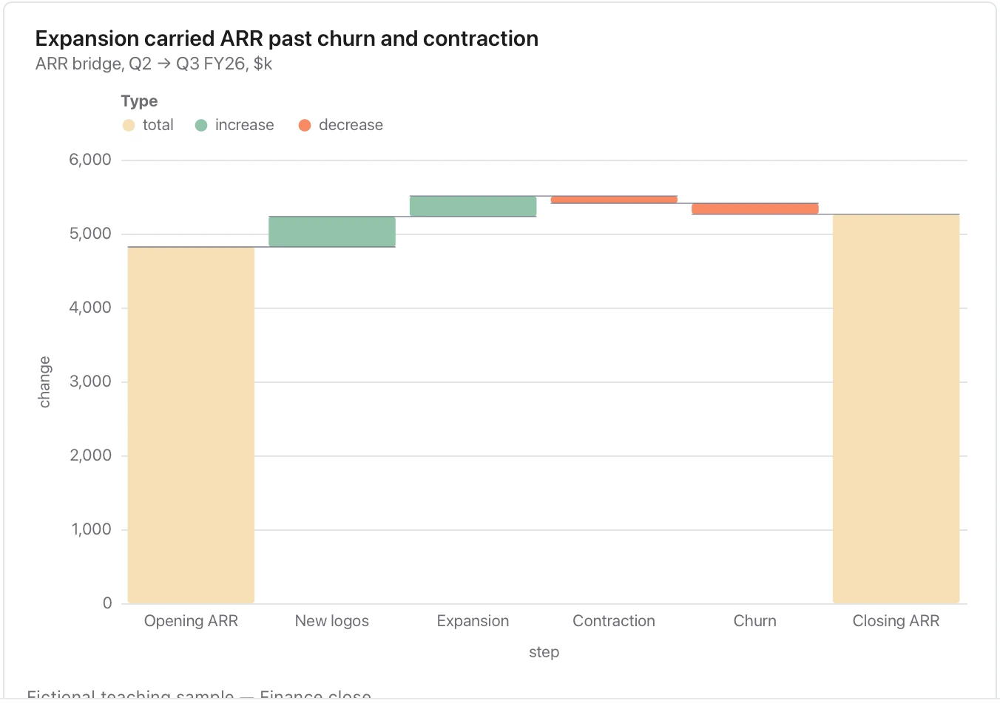

Check the arithmetic and distinguish totals from changes; a missing movement cannot be repaired by the chart.

**Takes:** a table of named steps and signed amounts, from an opening figure through additions and subtractions to a closing one, such as a revenue bridge or a headcount reconciliation.

