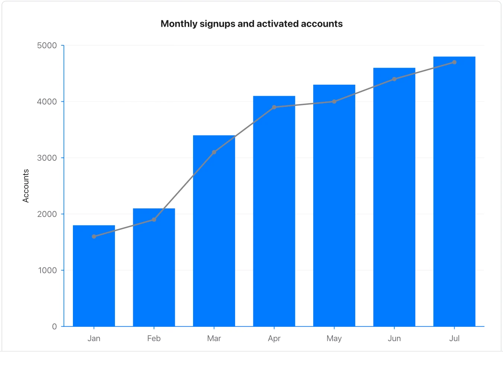

Keep units compatible and identify each series in the surrounding prose.

**Takes:** a date-and-value table when the document must render on GitHub as well as in Flow: a bar-plus-line over months without the chart fence. Bars show signups; the line shows activated accounts. Both use account counts, not percentages.

