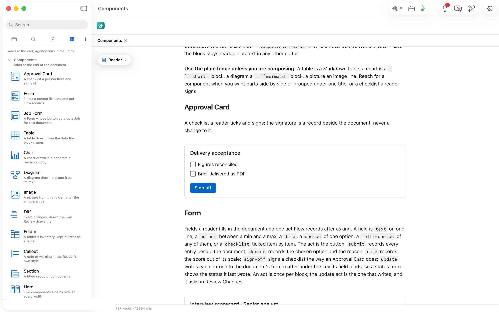

Signing writes one record beside the document; the document's text never changes.

````markdown
```flowui
component: Approval Card
title: Delivery acceptance
items:
  - Figures reconciled
  - Brief delivered as PDF
decision: {label: Sign off, action: sign-off}
```
````

Drawn: the title, a box per item, and a **Sign off** button.


