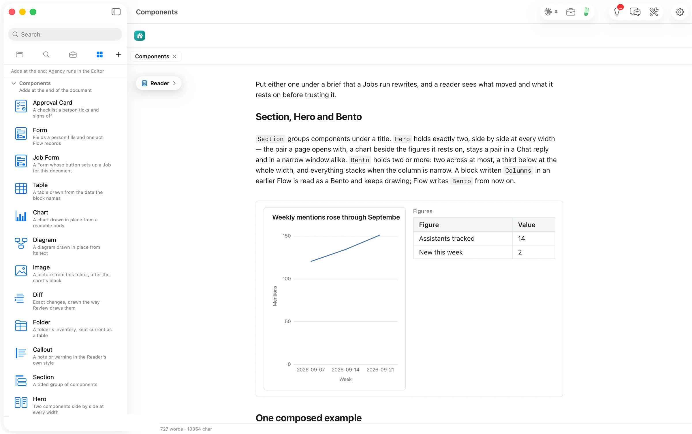
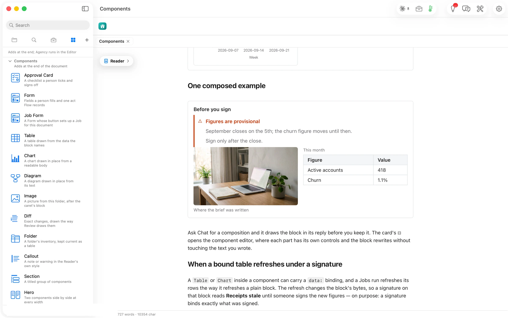

**Section** groups components under a title. **Hero** holds exactly two, side by side at every width. A chart beside the figures it rests on stays a pair even in a narrow window. **Bento** holds two or more, two across at most, and stacks when the column is narrow.

````markdown
```flowui
component: Hero
components:
  - component: Chart
    chart:
      chartType: Line Chart
      title: Weekly mentions rose through September
      data:
        - {week: "2026-09-07", mentions: 120}
        - {week: "2026-09-14", mentions: 134}
        - {week: "2026-09-21", mentions: 151}
      semantic_types: {week: Category, mentions: Amount}
      encodings:
        x: {field: week}
        y: {field: mentions}
  - component: Table
    title: Figures
    rows:
      - {Figure: Assistants tracked, Value: 14}
      - {Figure: New this week, Value: 2}
```
````



Composed, they read as one panel. Below, a **Section** titled *Before you sign* holds a warning and a **Bento** with the picture and the month's table.


