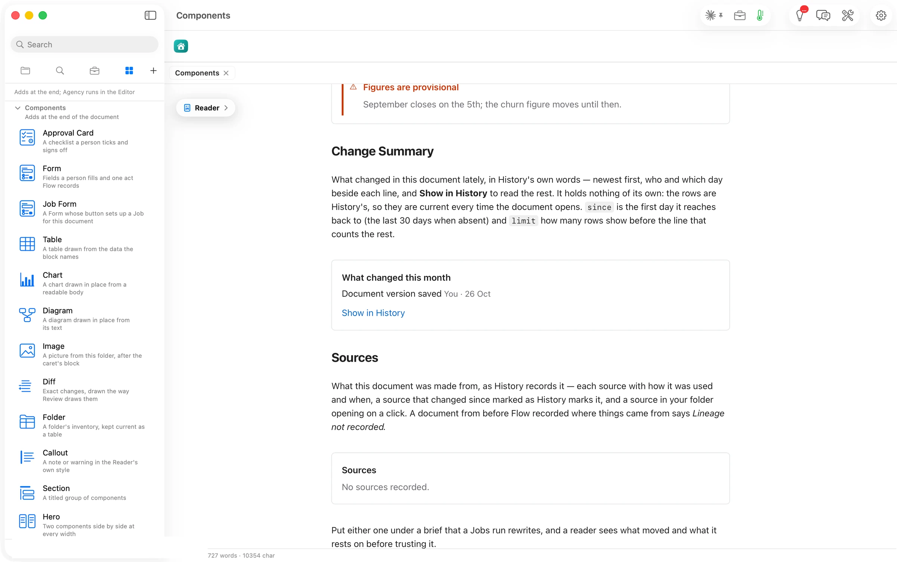

It holds nothing of its own, so it is current every time the document opens. `since` sets the first day it reaches back to, and `limit` how many rows it shows.

````markdown
```flowui
component: Change Summary
title: What changed this month
since: 2026-10-01
limit: 5
```
````


