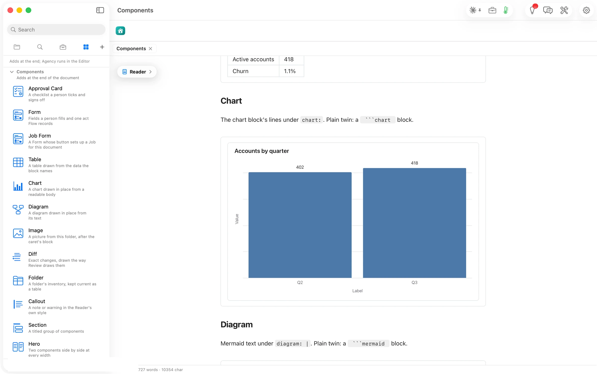

Its plain twin is a ` ```chart ` block, and the chart kinds article lists all 54 kinds.

````markdown
```flowui
component: Chart
chart:
  chartType: Bar Chart
  title: Accounts by quarter
  data:
    - {label: Q2, value: 402}
    - {label: Q3, value: 418}
  semantic_types: {label: Category, value: Amount}
  encodings:
    x: {field: label}
    y: {field: value}
```
````


