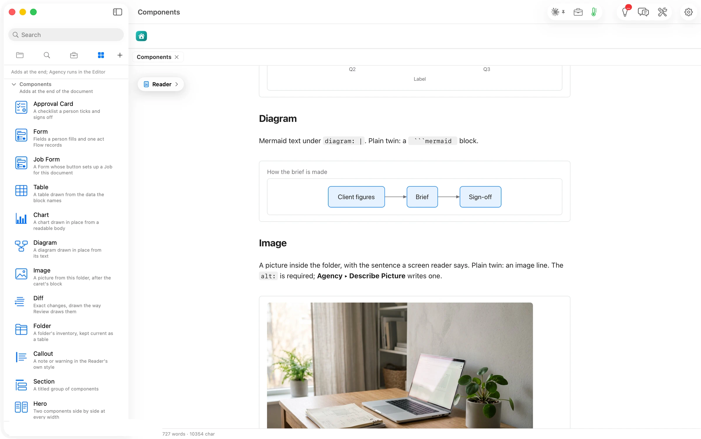

Its plain twin is a ` ```mermaid ` block.

````markdown
```flowui
component: Diagram
title: How the brief is made
diagram: |
  flowchart LR
    A[Client figures] --> B[Brief] --> C[Sign-off]
```
````


