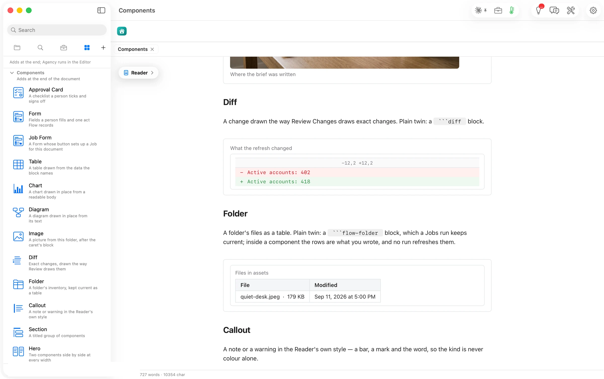

Its plain twin is a ` ```diff ` block.

````markdown
```flowui
component: Diff
title: What the refresh changed
diff: |
  @@ -12,2 +12,2 @@
  -Active accounts: 402
  +Active accounts: 418
```
````


