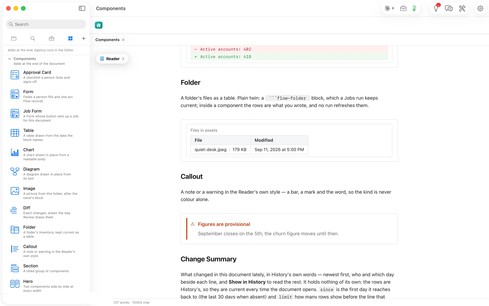

Inside a component the rows are what you wrote. Its plain twin, a ` ```flow-folder ` block, is the one a Job keeps current.

````markdown
```flowui
component: Folder
folder: assets
rows:
  - {File: quiet-desk.jpeg, Size: 178715, Modified: 2026-09-12}
```
````


