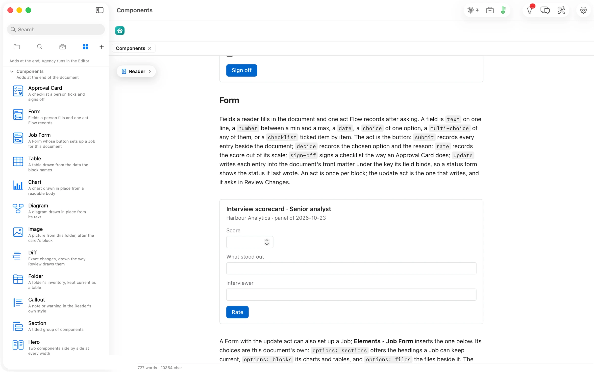

A field is text, a number between a minimum and a maximum, a date, one choice, any of several, or a checklist. The act is one of five. **Submit** records every entry beside the document, **decide** records the chosen option and the reason, **rate** records a score, **sign-off** signs like an Approval Card, and **update** writes each entry into the document's front matter, through Review Changes.

````markdown
```flowui
component: Form
title: Interview scorecard · Senior analyst
subtitle: Harbour Analytics · panel of 2026-10-23
fields:
  - {label: Score, bind: score, type: number, min: 1, max: 5}
  - {label: What stood out, bind: note}
  - {label: Interviewer, bind: signer}
decision: {label: Rate, action: rate}
```
````


