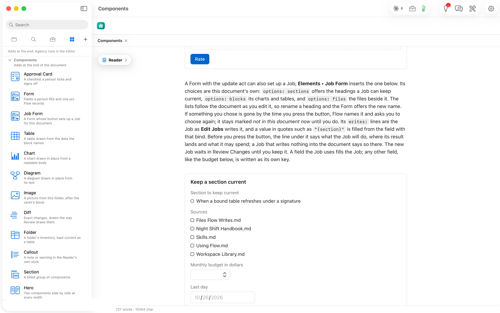

Its choices come from the document itself. `options: sections` offers its headings, `options: blocks` its charts and tables, `options: files` the files beside it. The lists follow the document as you edit it. The new Job waits in Review Changes until you keep it.

````markdown
```flowui
component: Form
title: Keep a section current
fields:
  - {label: Section to keep current, bind: section, type: choice, options: sections}
  - {label: Sources, bind: sources, type: multi-choice, options: files}
  - {label: Monthly budget in dollars, bind: budget, type: number, min: 0, max: 20}
  - {label: Last day, bind: until, type: date}
decision: {label: Set up the Job, action: update}
writes:
  jobs:
    - kind: expand-with-sources
      section: "{section}"
      sources: "{sources}"
      until: "{until}"
```
````


