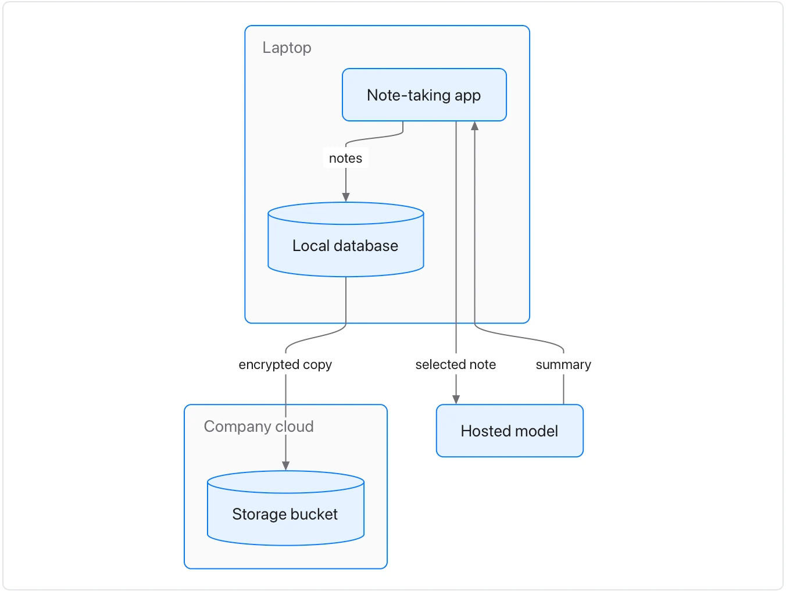

Use it when a document explains how a product, service or pipeline is put together. **Needs:** at least 2 separate points. **One run returns:** only a diagram of the parts and their flows.

> The note-taking app keeps every note in a local database on the laptop. When a person asks for a summary, the app sends the selected note to a hosted model and writes the summary back into the note. Sync sends encrypted copies of the database to the company's storage bucket in its own cloud account.

