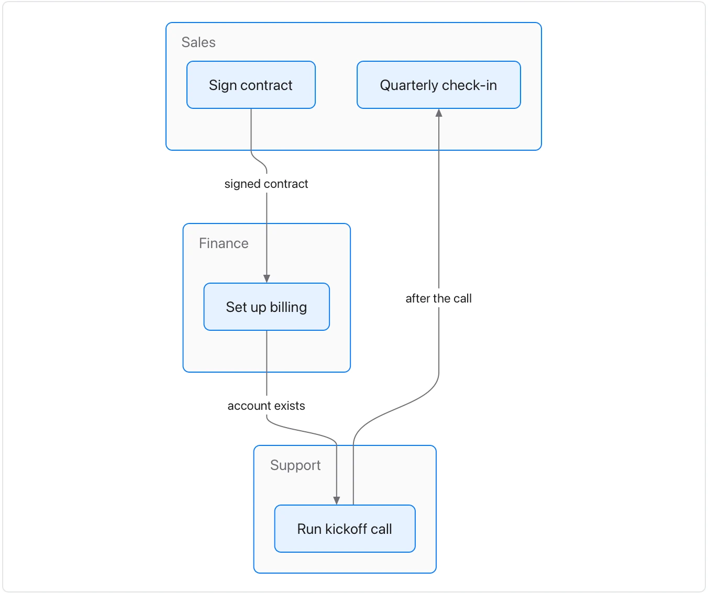

Use it when a document describes a process that several people or teams share. **Needs:** at least 2 separate points. **One run returns:** only a flowchart of who does each step.

> A new customer's contract is signed by sales, who send it to finance to set up billing. Finance tells support once the account exists, and support runs the kickoff call. After the call, support hands the customer back to sales for the quarterly check-in. Finance says the hand-off from sales often arrives without the billing contact.

