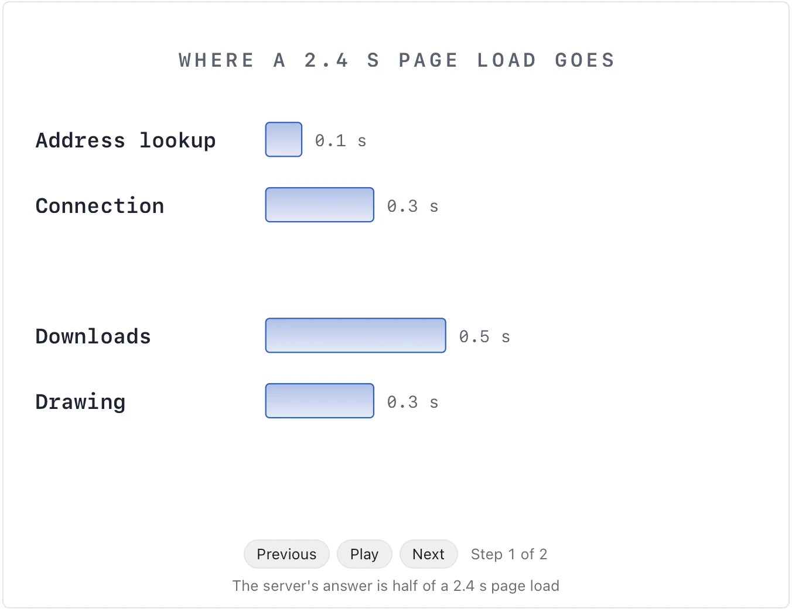

Use it when a passage explains a technical concept through measurements, sizes, costs, timings or counts, and a reader should see their proportions. **Needs:** at least 2 numbers. **One run returns:** an animated infographic you step through.

> A product page takes 2.4 seconds to load. Looking up the address takes 0.1 s, opening the connection and its encryption 0.3 s, and the server takes 1.2 s to answer. Downloading the images and scripts then takes 0.5 s, and drawing the page 0.3 s. The server's answer is half of the wait, and it is the part worth fixing first.

