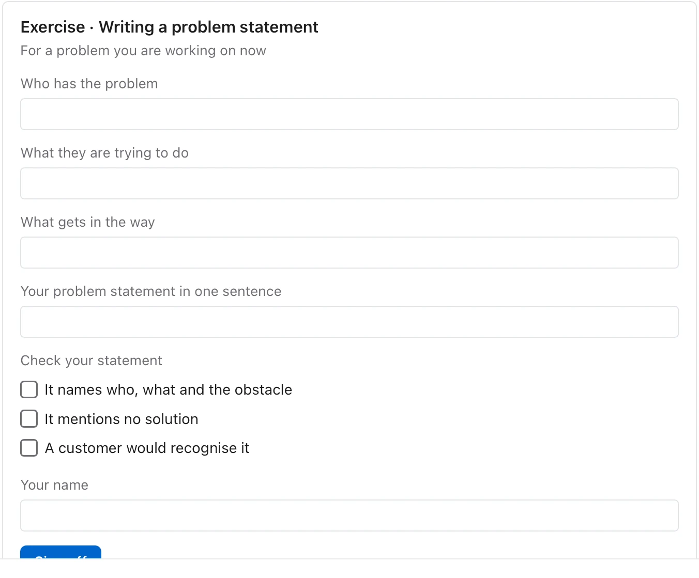

Use it when a document teaches something a reader should try for themselves. **Needs:** at least 2 separate points. **One run returns:** only a form a learner works through and signs.

> A good problem statement names who has the problem, what they are trying to do, and what gets in the way — before it mentions any solution. Write it in one sentence, then test it by asking whether a customer would recognise it.

