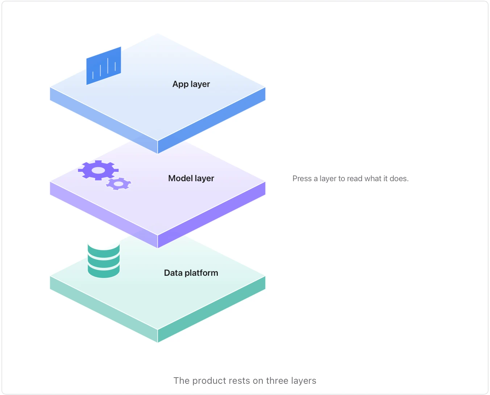

Use it when a document describes something built in layers — a technology stack, an organisation's tiers, a product's levels. **Needs:** at least 2 separate points. **One run returns:** an interactive visual. Press a layer to lift it and read what it does.

> Our product rests on three layers. At the bottom, the data platform stores every customer event and keeps it for two years. On top of it, the model layer turns those events into forecasts each night. The app layer, on top, shows each team its forecast and lets them adjust it.

