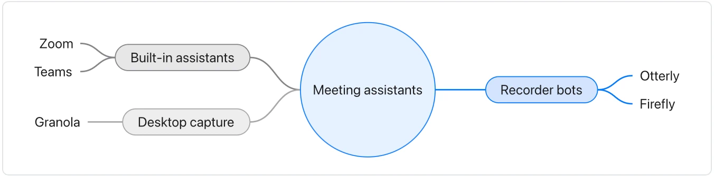

Use it when a document surveys a market, a field or a set of alternatives. **Needs:** at least 3 separate points. **One run returns:** a mind map and a table.

> Meeting assistants split three ways. Recorder bots such as Otterly and Firefly join the call as a participant (per each vendor's site). Built-in assistants come with the meeting tool itself: Zoom's and Teams' own (their 2026 release notes). Desktop capture tools such as Granola record from the laptop without joining the call.

