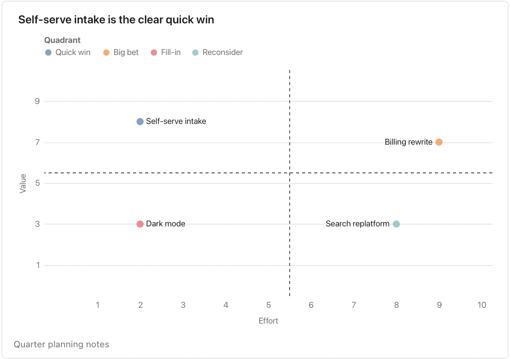

Use it when a document lists options to prioritise. **Needs:** at least 2 separate points. **One run returns:** a chart of value against effort and a table.

> This quarter we could ship self-serve intake, which support says would remove a third of their tickets and takes one engineer two weeks. A billing rewrite would fix the invoicing errors finance complains about but needs three engineers for a quarter and a migration. A dark-mode theme is a common request with little revenue behind it; a designer estimates a week. Replatforming search onto a new engine would cut hosting cost slightly and take two months of the platform team.

