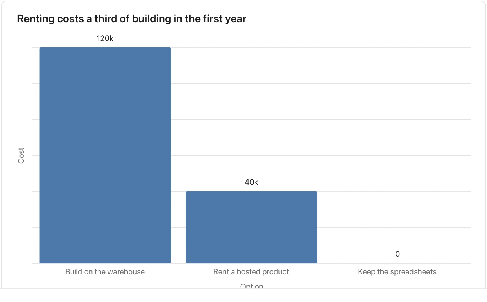

Use it when a document is choosing between a few ways forward. **Needs:** at least 2 separate points. **One run returns:** a table, and a chart when the options share one measure in one unit; otherwise it says why there is none.

> For the new analytics stack we can build on our warehouse, which the data team prices at $120k in the first year and four months of work; rent a hosted product at $40k a year, live in three weeks, though our data then leaves our cloud; or keep the spreadsheets we have, which costs nothing new but cannot handle next year's volume.

