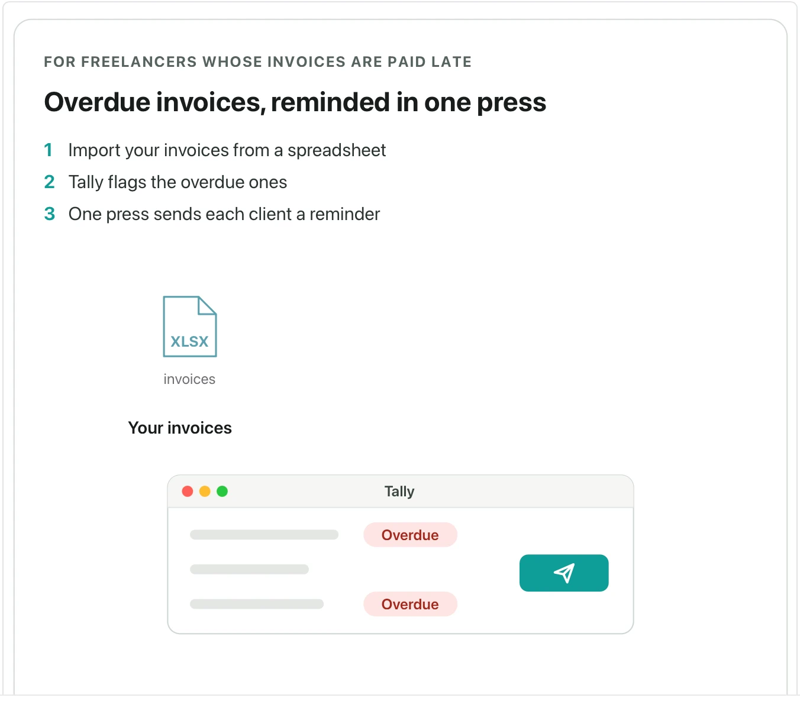

Use it when a document introduces a feature, a service or an offer, and a reader should grasp it at a glance. **Needs:** at least 2 separate points. **One run returns:** an animated card you step through.

> Tally's reminders are for freelancers whose invoices are paid late. Import your invoices from a spreadsheet, Tally flags the overdue ones, and one press sends each client a reminder with the invoice attached as a PDF. In a pilot with 40 invoices, freelancers were paid 9 days sooner on average.

