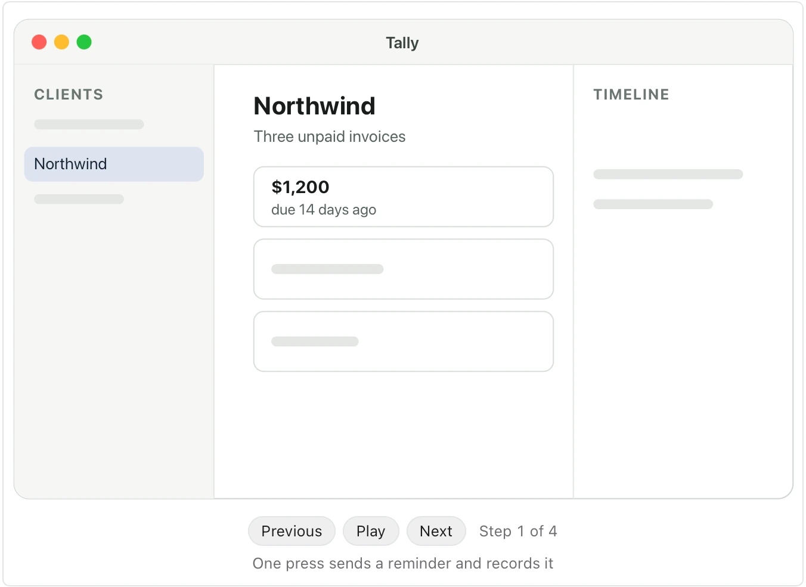
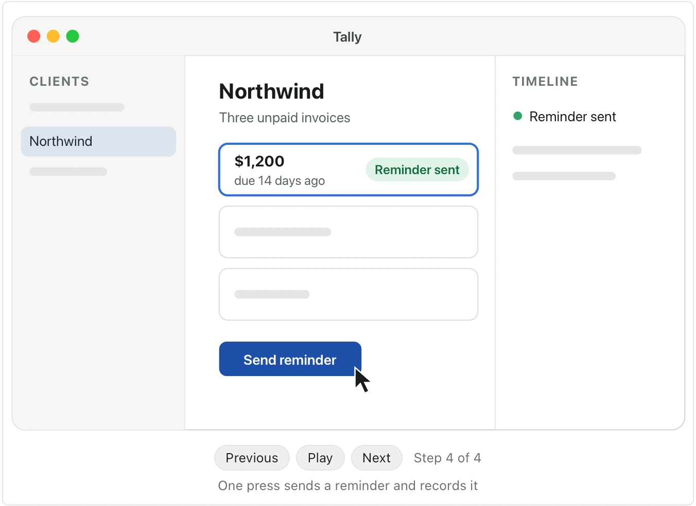

Use it when a document describes how someone uses a product, a feature or a prototype, and a reader should see it happen. **Needs:** at least 3 separate points. **One run returns:** an animated mock you step through.

> In Tally, a freelancer's invoicing app, Maya opens her list of clients and picks Northwind. The client's page shows three unpaid invoices. She presses Send reminder on the oldest one, $1,200, due 14 days ago. Tally marks the invoice Reminder sent and adds the reminder to the client's timeline.

