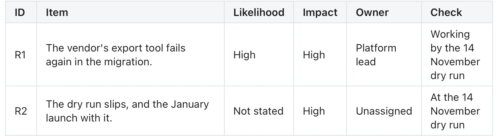

Use it when a document raises things someone must keep an eye on. **Needs:** at least 2 separate points. **One run returns:** only a table.

> The migration depends on the vendor's export tool, which failed twice in testing; the platform lead is chasing them and wants it working by the 14 November dry run. Legal has not yet confirmed the new data residency terms. If the dry run slips, the January launch slips with it, which marketing says would be costly.

