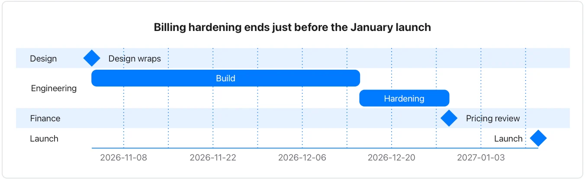

Use it when a document plans work with dates, durations or a sequence. **Needs:** at least 2 separate points and a date. **One run returns:** only a timeline chart.

> Design for the new billing flow wraps on 3 November 2026. Engineering starts the same day and needs six weeks, then two weeks of hardening. Finance wants a pricing review once hardening is done, and the launch is set for 12 January 2027. Marketing will start the launch page in December.

