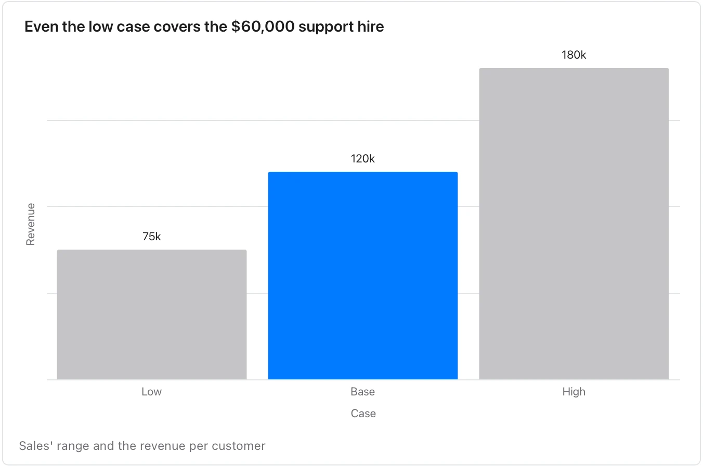

Use it when a document plans against an uncertain number. **Needs:** at least 2 numbers. **One run returns:** a chart and a form.

> We expect 40 new customers next quarter, though sales says it could be anywhere from 25 to 60. Each brings about $3,000 in the quarter. The support hire we are weighing costs $60,000 a quarter.

