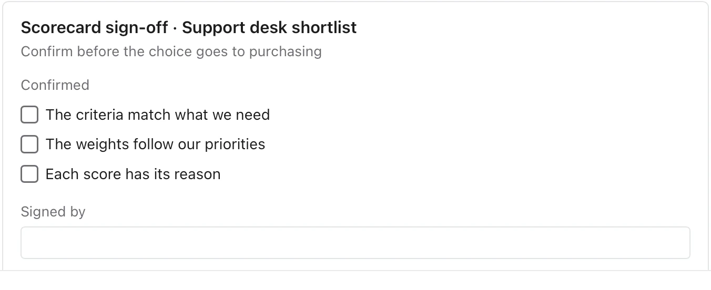

Use it when a document compares a few candidates against stated criteria. **Needs:** at least 2 separate points. **One run returns:** a table and a sign-off form.

> We shortlisted two support desks. Price matters most, then the integrations, then setup time. Helpline is $40 a seat and needs a month to set up, but connects to our CRM and billing. Deskly is $25 a seat and sets up in a week, though it only connects to the CRM.

