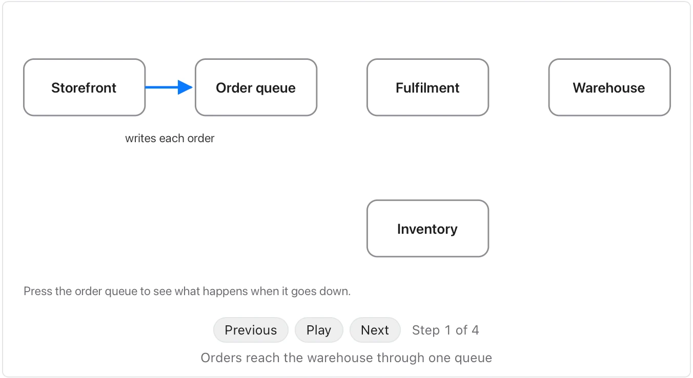
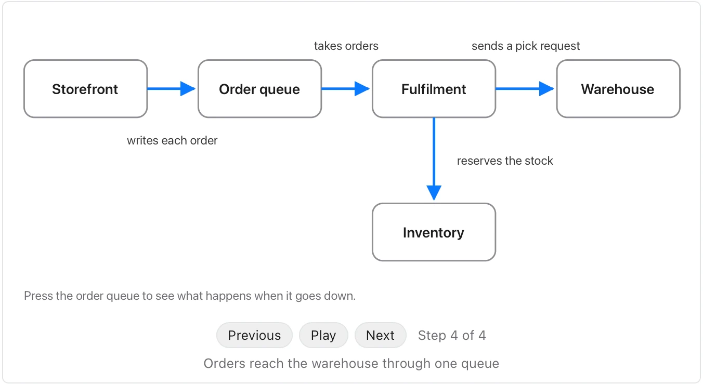

Use it when a document describes how components, teams or stages pass work to each other. **Needs:** at least 2 separate points. **One run returns:** an animated visual you step through, with parts you can press.

> Customers place orders on the storefront, which writes each order to the order queue. The fulfilment service takes orders from the queue, asks the inventory service to reserve the stock, then sends a pick request to the warehouse. The queue is the single point of failure: if it goes down, the storefront keeps taking orders but cannot hand them on, so they wait in its retry buffer and nothing reaches the warehouse until the queue recovers.

