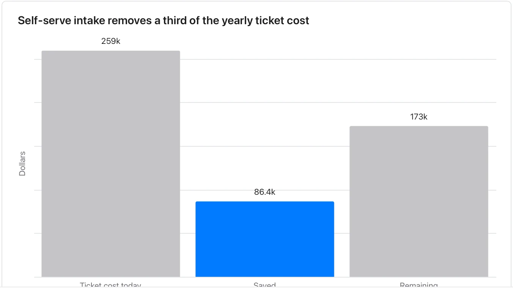

Use it when a document argues that something is worth doing and gives numbers for it. **Needs:** at least 2 numbers. **One run returns:** a table of its assumptions and a chart.

> Support handles about 1,200 tickets a month. Their lead estimates self-serve intake would remove a third of them. Finance puts the loaded cost of a ticket at $18.

