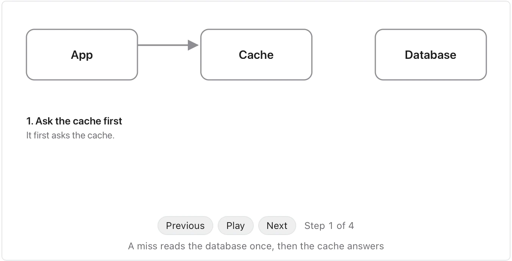
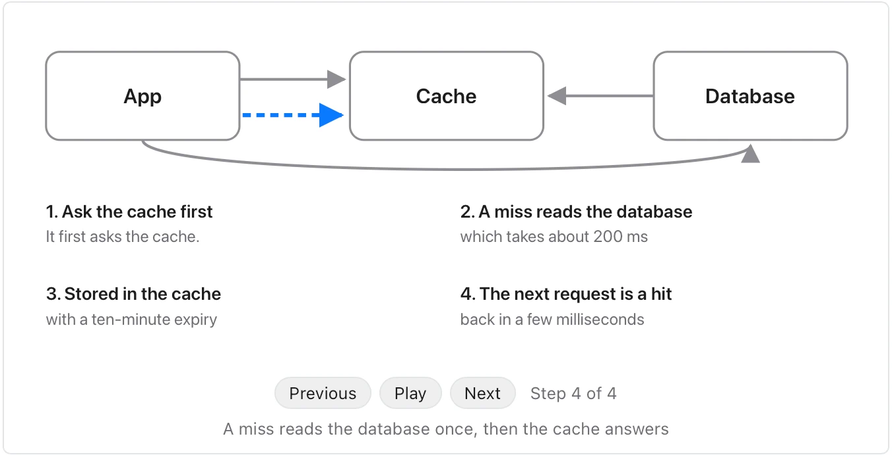

Use it when a passage explains how something works and a reader would follow it faster as a picture. **Needs:** at least 2 separate points. **One run returns:** an animated visual you step through.

> When the app needs a product page it first asks the cache. If the cache has the page, it comes back in a few milliseconds. If not, that is a miss: the app reads the page from the database, which takes about 200 ms, stores it in the cache with a ten-minute expiry, and returns it. The next request for the same page is a hit.

