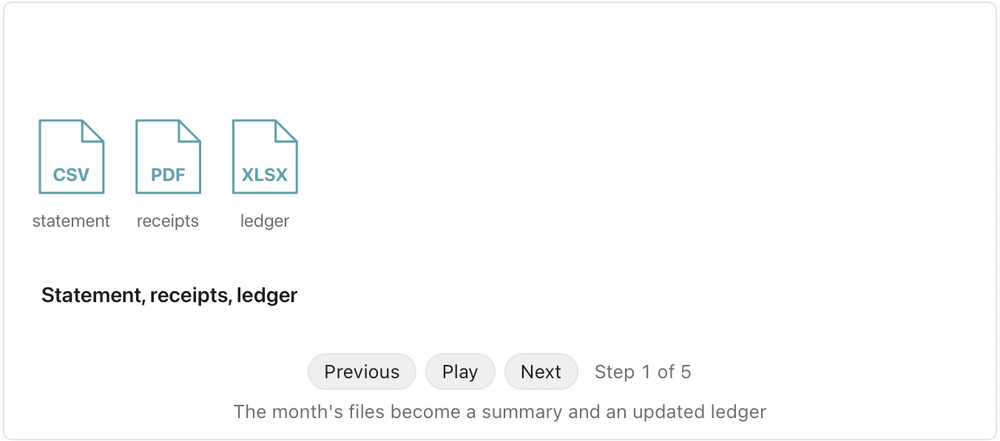
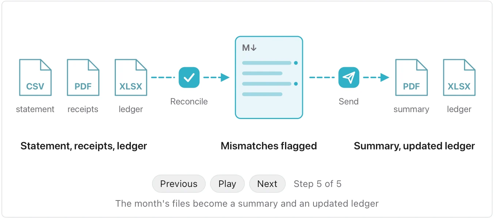

Use it when a document describes a recurring piece of work and a reader should see its shape at a glance. **Needs:** at least 2 separate points. **One run returns:** an animated path you step through.

> At the start of each month I export the client's bank statement as a CSV and gather the receipts they emailed as PDFs. I reconcile both against the client's ledger and flag anything that does not match. Then I send the client a one-page summary as a PDF and the updated ledger as a spreadsheet.

