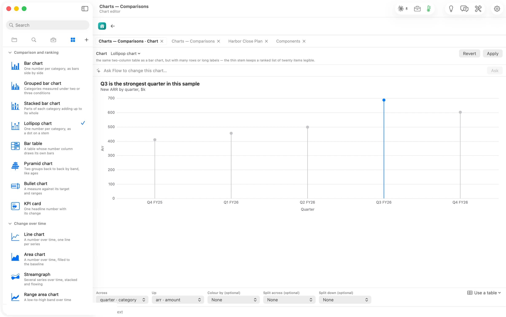

## What Flow does

**Every chart Flow can draw is one press away, and Flow tells you which ones your data can make.**
Open any chart or diagram in Orionfold Flow and the sidebar's Elements panel lists the kinds by question: **Comparison and ranking**, **Change over time**, **Composition and flow**, **Distribution and relationship**, and **Diagrams**. Each card shows the shape, says what the kind shows, and, when you rest on it, what data gets you there. Press a kind and the chart redraws with your data kept. If your data can't take that kind, the chart stays as it was, and the card and the editor say what the kind needs. You can start from Flow's example, or keep yours. **Format ▸ Chart Type** lists the same kinds for the keyboard.

## The answer first

1. **Open a chart or diagram in its editor**: hover it in the document and press **Open in the gallery**, or insert one from **Elements ▸ Chart**.
2. **Press ⌘5.** Elements lists the kinds for that block, grouped by question, with the current one checked.
3. **Rest the pointer on a kind**, or reach it with the arrow keys, to read what data it takes.
4. **Press it** (or Return). The chart redraws with your data. Press **Apply** to keep it or **Revert** to go back.
5. **If the kind can't use your data**, the card says *Your data doesn't fit it*, and the editor names what the kind needs and offers **Start from the example** or **Keep mine**.

## The job

A table of numbers can become a dozen pictures, and most of them mislead. Bars where a line belongs hide the trend. A pie with nine slices hides the shares. A histogram of three values shows nothing. Choosing well means knowing what each kind is for and what shape of data it expects. That knowledge usually lives in a style guide nobody opens. Flow puts it on the card, next to the chart.

## Switch, with your data kept

Pressing **Lollipop chart** redrew the five quarters as stems and dots, Q3 still in the accent colour. The check moved, and the editor's header changed to the new kind's need. *It wanted the same two-column table as a bar chart, but with many rows or long labels*.

Pressing **Candlestick chart** on the same data changed nothing. The card turned orange, *Your data doesn't fit it; the pane offers the example*, and the editor said exactly why. *It needs a table of date, open, high, low and close*. **Keep mine** and **Revert** left the file as it was; read back afterwards, it was byte for byte the Guide's original.

## The numbers

| Figure | Value | Status and source |
| --- | --- | --- |
| Chart kinds, with a chart open | 34, in four groups (8, 10, 6, 10) | verified: the panel's list, read 14:40–14:42 |
| Diagram kinds, with a diagram open | 20 | verified: the panel's list, read 14:43–14:44 |
| Switch from bar to lollipop | one press, data kept | verified: the editor's kind read *Lollipop chart* after the press |
| A kind the data can't take | refused, chart unchanged, what it needs named | verified: the card's value and the editor's line, 14:09 |
| File after Keep mine and Revert | byte-identical to the Guide's | verified: git hash `458a2114…` on both |
| Model calls to switch a kind | none | assumed: the switch showed no route or cost line and finished at once |
| Machine | MacBook Pro M3 Max, 36 GB, macOS 26.6 | verified |
