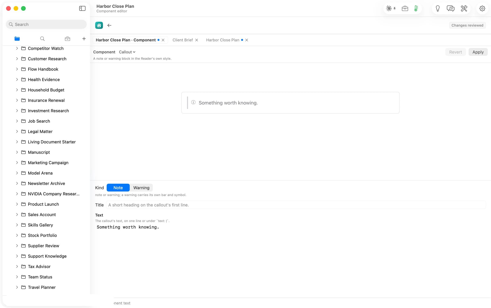
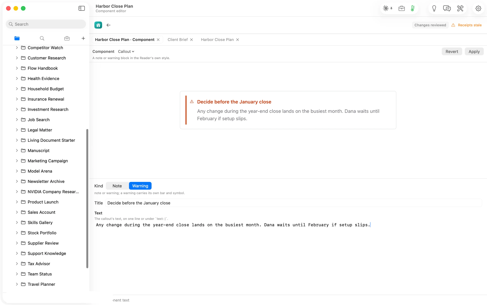
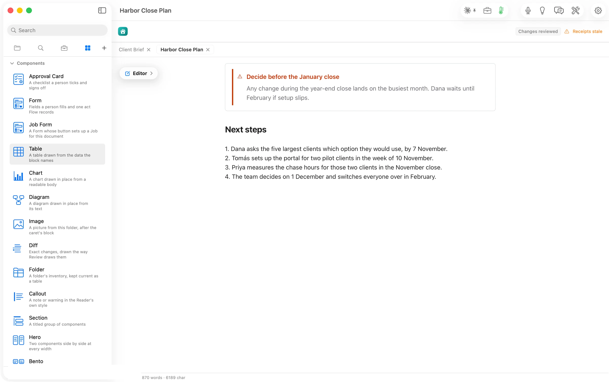
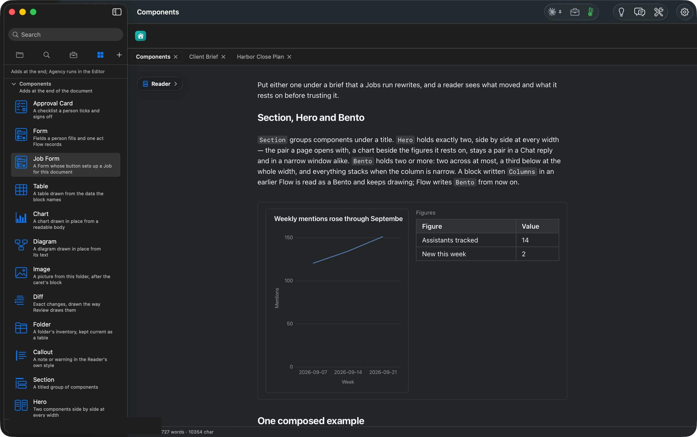

## What Flow does

**A Flow document can now hold the parts a real deliverable needs, and every one of them is still plain text.**
Open Elements (⌘5) and the **Components** section lists fifteen blocks, each with a drawing and one line. Press one in the Editor and Flow places a starter after the caret and opens the component editor. It shows the block's fields as controls, and the block drawn live above them. Press **Apply** and you are back in the document on the line after it. In the file, a component is a ` ```flowui ` block of a few YAML lines, such as `component: Callout` and `kind: warning`, so the document reads the same in any editor and Flow draws it as one of its own surfaces. A checklist records its signature beside the document rather than in it. A form records its one act after asking. A Job Form sets up a Job that keeps a section current. Hero and Bento put two components side by side.

## The answer first

1. **Open a document in the Editor and put the caret where the block should go.**
2. **Press ⌘5 and press a card under Components.** Flow writes a starter after the caret and opens the component editor. From the Reader, the card adds the block at the end of the document instead.
3. **Fill in the fields.** The block redraws above them as you type.
4. **Press Apply** (⌘↩). The Editor comes back with the caret on the line after the block.
5. **To change it later**, hover the block and press its **⊟**, or put the caret in it and choose **Format ▸ Edit Component**. **Format ▸ Insert Component** lists the same blocks.

## The job

A deliverable is rarely only prose. A monthly brief needs its figures in a table, a chart beside them, a warning that the numbers are provisional, and a place for the client to sign. A status page needs a form whose answer lands in the document. In most editors these parts live elsewhere. They sit in a spreadsheet, an e-signature service, a slide. Flow draws them inside the document and keeps them as text the document owns.

## From the card to the page



On *Harbor Close Plan*, with the caret after the Risks paragraph, the **Callout** card opened the component editor. The starter reads *Something worth knowing.* The controls are the Callout's inputs: **Kind** (Note or Warning), **Title** and **Text**.



Choosing **Warning** and typing a title and a sentence redrew the preview as each field changed.



**Apply** returned to the plan with the warning drawn above *Next steps*, and Elements came back where it was. In the file the block is five lines:

````markdown
```flowui
component: Callout
kind: warning
title: Decide before the January close
text: Any change during the year-end close lands on the busiest month. Dana waits until February if setup slips.
```
````



Every component redraws for dark mode.

Two Agency actions draft components from your own words. **Sign-off** drafts an Approval Card and **Form** drafts a form, and both arrive in Review Changes; the Agency article shows each. Ask Flow Chat for a status form or a composition and it draws the block in its reply before you keep it.

## The numbers

| Figure | Value | Status and source |
| --- | --- | --- |
| Cards under Components | 15 (14 blocks plus Job Form) | verified: the panel's list, read 14:26 |
| Form field kinds | 6 (text, number, date, one choice, any of several, checklist) | verified: the Handbook's Components page |
| Form acts | 5 (submit, decide, rate, sign-off, update) | verified: the Handbook's Components page |
| Lines the Callout took in the file | 5 inside its fence | verified: the file read back after Apply, 14:28 |
| Cost of inserting and editing a component | none | assumed: the insert and the component editor showed no route or cost line, unlike every model run in the set |
| Machine | MacBook Pro M3 Max, 36 GB, macOS 26.6 | verified |
