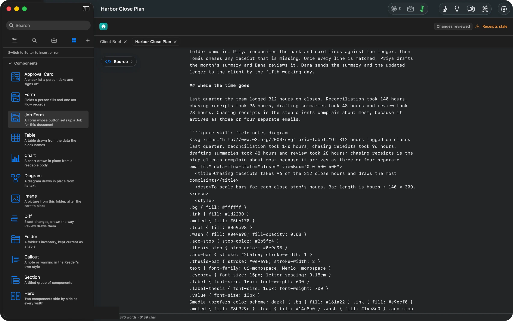
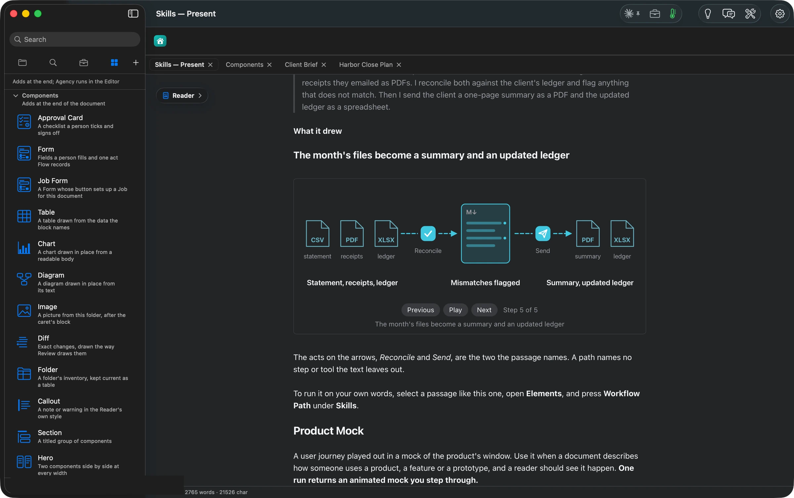

## What Flow does

**Select a paragraph, press a skill, and Flow draws its case as the brief, the table, the timeline or the figure.**
Orionfold Flow ships nineteen skills, listed in Elements (⌘5) under **Skills**. Each turns one kind of passage into the form that reader needs. A discussion of choices becomes a decision brief with a decision tree. A list of initiatives becomes a value-and-effort map. Dated work becomes a roadmap, and a layered system becomes an isometric figure you can press. A recurring piece of work becomes a path from files in to deliverables out. Before anything runs, the skill's sheet counts whether your text has what the method needs, such as separate points, numbers or a date, and recommends **Cancel** when it doesn't. The result is placed right after the paragraph you selected and waits in **Review Changes**. What a skill draws is saved in the document as text, so it opens anywhere and prints when you publish. Ideas can choose the skill for you, section by section.

## The answer first

1. **Select the passage the skill should read.** With nothing selected, it reads the whole document.
2. **Press ⌘5 and press the skill's card under Skills.** Or let **Ideas** (⌘3) suggest one per section and press the idea.
3. **Read the sheet.** It shows what the skill will read, its steps, and a check of what your text has: *46 words to read · 5 numbers to work with*. Press **Run Skill** when it says *Ready to run*.
4. **Review the result** in **Review Changes**. A figure that builds in steps has **Previous**, **Play** and **Next** under it. Keep it, or discard it.
5. **Open the Flow Guide's Skills Gallery** to see every skill's passage and what it drew, grouped by the question your text asks. The groups are Decide, Plan, Explain, Present.

## The job

A plan that says "three options, here are the costs" asks the reader to build the comparison in their head. A paragraph about who hands what to whom asks them to draw the flowchart. Most people know the form their argument wants, such as a table, a timeline or a map. Few have the time to draw it in another tool and keep it in step with the text. A skill draws it from the text you already wrote, in a form Flow keeps as part of the document.

## A skill, run on a real section

On *Harbor Close Plan*, Ideas suggested **Field-Notes Diagram** for the section *Where the time goes*. Pressing the idea selected the section and opened the skill's sheet. It showed its six steps, and a check that found *5 numbers to work with*. Every skill opens the same sheet when you press its card yourself.

The figure arrived in **Review Changes** about 50 seconds later, after the section it read. Each bar is its number drawn to scale, and the number the passage stresses is the one in colour.

Kept, the figure is a block of text in the Markdown file. It is a `figure` fence holding the drawing, with its title and a description a screen reader can say. It travels with the document and redraws in dark mode.

## The numbers

| Figure | Value | Status and source |
| --- | --- | --- |
| Skills in Elements | 19 | verified: the panel's list |
| Skills that draw a figure you step through or press | 7 (System Explainer, Visual Explainer, Isometric Figure, Field-Notes Diagram, Workflow Path, Product Mock, Path Card) | verified: each SKILL.md's `output: [figure]` |
| Field-Notes Diagram, idea press to Review | about 50 s | verified: clock 13:59:13 to 14:00:03 |
| Numbers the sheet found in the section | 5 | verified: the sheet |
| Bars drawn to scale | widths = hours ÷ 140 × 300 | verified: the saved figure's text |
| Cost of the live run | $0 extra, on the Claude subscription | verified: the sheet's cost and route lines |
| Gallery passages and drawings | 19, one per skill | verified: the Skills Gallery pages, shot 14:11–14:14 |
| Machine | MacBook Pro M3 Max, 36 GB, macOS 26.6 | verified |
