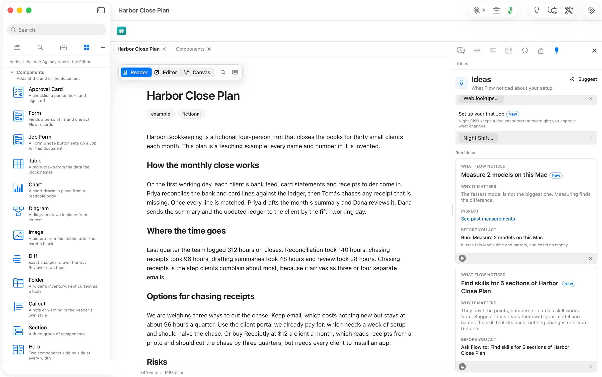
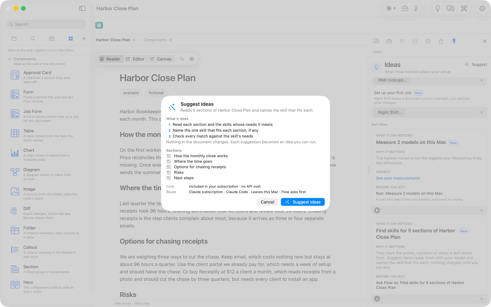
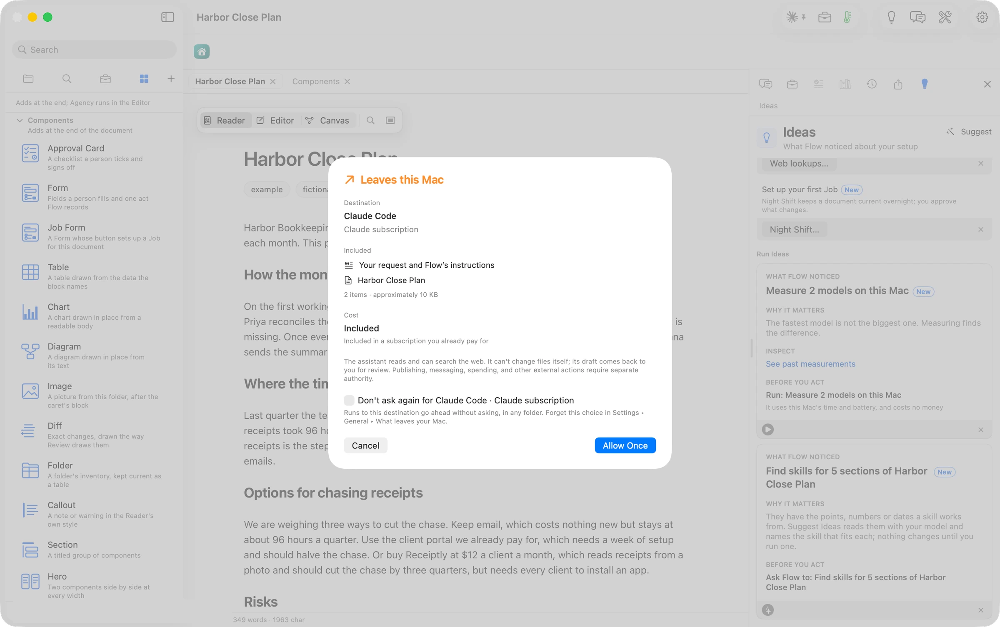
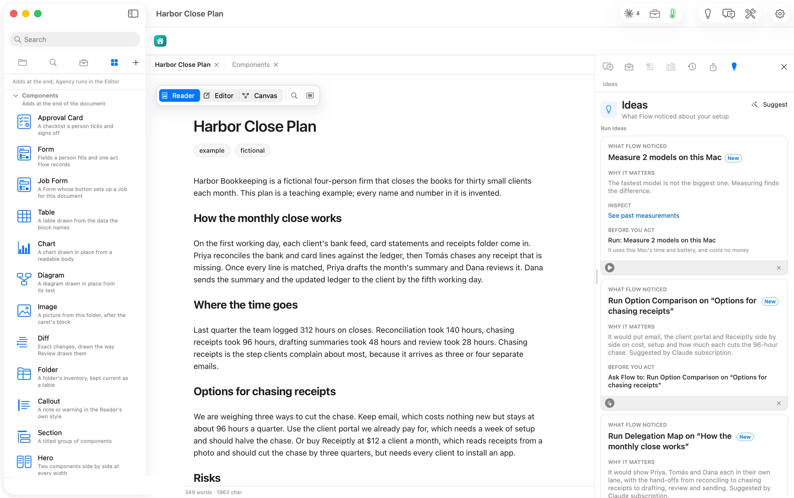
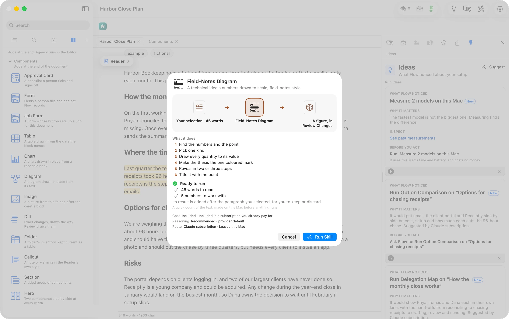
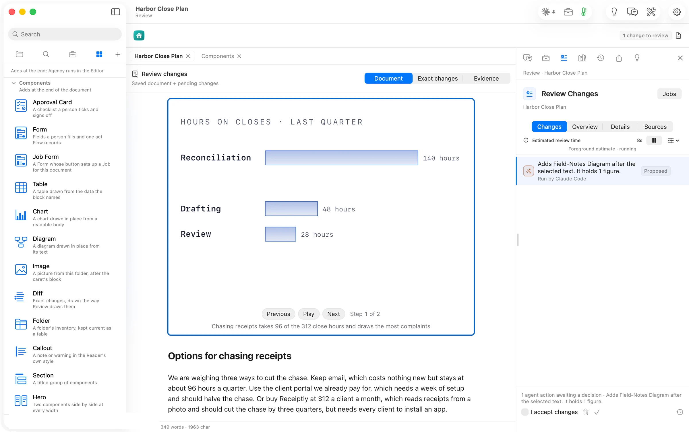
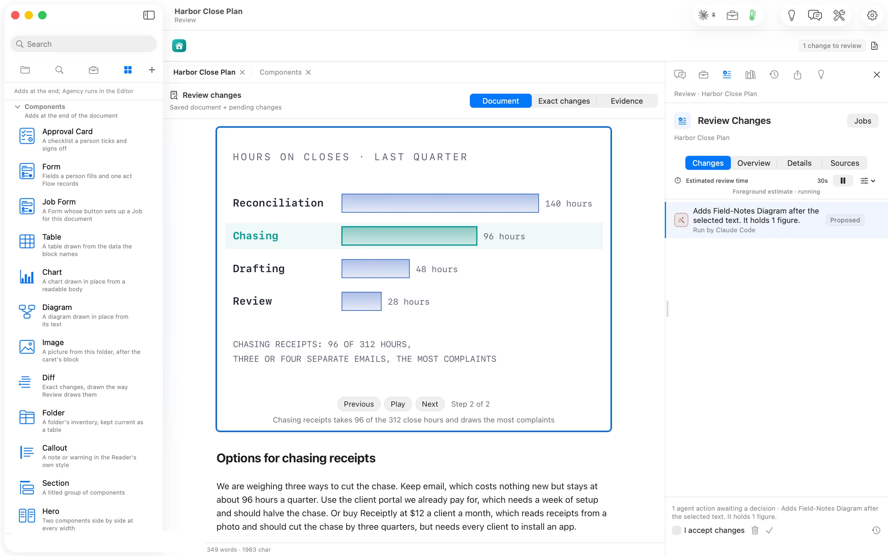
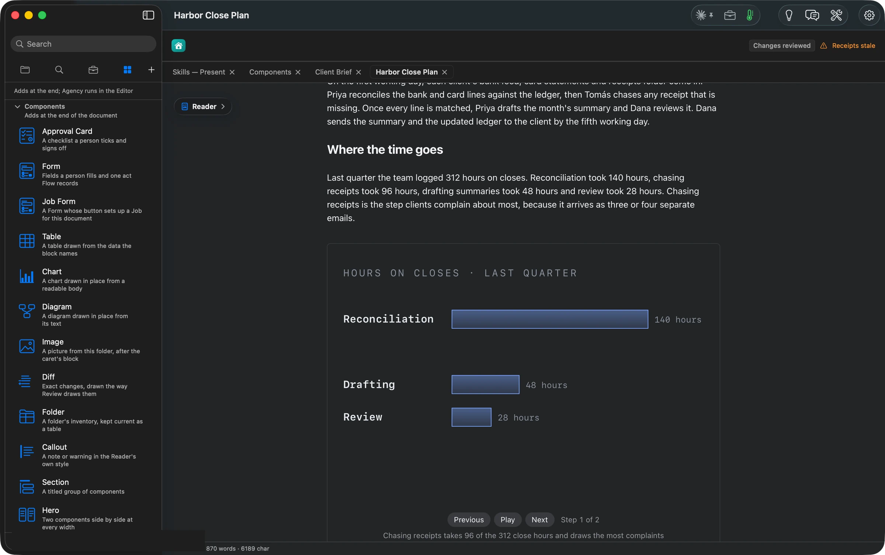

## What Flow does

**Everything a document can take now sits in one place, and Flow suggests which of it fits.**
Press ⌘5 in Orionfold Flow and the Elements panel opens in the sidebar. It holds a card for every block Flow draws inside a document: checklists you can sign, forms, tables, charts, diagrams, pictures, notes and side-by-side layouts. Below them sit the Agency actions that rewrite or extend your words, and nineteen skills that turn a passage into a decision brief, a roadmap, a register or an animated figure. Open a chart and the same panel shows the 54 chart and diagram kinds, each with what data gets you there. You don't have to know which to pick: Ideas reads your document, names the one skill that fits each section, and says why. Everything a card adds waits in Review Changes until you keep it.

## The answer first

1. **Open a document and press ⌘5** (or **View ▸ Elements**). The sidebar shows **Components**, **Agency** and **Skills**, each a section you can fold.
2. **To add a block**, press its card. In the Editor it goes after the caret and opens its editor, so you can fill in its fields. In the Reader it goes at the end of the document.
3. **To run an action or a skill**, select the passage first, then press the card. With nothing selected it reads the whole document. Its result waits in **Review Changes**.
4. **To let Flow choose**, open **Ideas** (⌘3). When your document has sections a skill could work on, Ideas offers **Find skills for N sections**. Press it, check the sheet, and press **Suggest Ideas**. Each suggestion becomes an idea such as **Run Field-Notes Diagram on "Where the time goes"**; pressing it opens that skill on that section.
5. **To change a chart's kind**, open the chart, then press a kind in Elements. Your data stays; if it can't take that kind, Flow says what the kind needs.

## The job

A plan, a brief or a status report says more when part of it is drawn: the decision as options side by side, the risks as a register, the hours as bars to scale. Most people know the content but not the form. Which chart? Is this a table or a timeline? What would a reader need to sign? Elements puts every form Flow can draw in one list, with a picture of each. Ideas does the matching for you when you'd rather not choose.

The walk used a short plan: *Harbor Close Plan*, five sections about how a fictional bookkeeping firm closes its clients' books, where the hours go, three options for cutting the time spent chasing receipts, the risks, and the next steps.

## Four groups, as the sidebar shows them

| Group | What a card does | Cards | Read on |
| --- | --- | --- | --- |
| **Components** | Adds a block Flow draws inside the document, written as a few plain lines any editor can read | 15 | [Components](/flow/elements/components/) |
| **Agency** | Rewrites or extends the selected text: proofread, summarize, translate, tables, charts, checklists, forms, briefs, pictures | 12 | [Agency](/flow/elements/agency/) |
| **Skills** | Applies a method to a passage and draws the answer: a brief, a map, a register, a figure you step through | 19 | [Skills](/flow/elements/skills/) |
| **Chart and diagram kinds** | With a chart or diagram open: switches it to another kind, data kept | 54 | [Chart and diagram kinds](/flow/elements/chart-kinds/) |

The **Agency** heading says, before you press anything, what an action would read, where it would run and on which model: the word count and *whole document* (or *selection* when text is selected), then *Claude Code · Claude subscription*. An action that can't run on what you have says why on its own row, in orange. For example, Convert Table to Text says *Select one whole table*.

Each **skill** has a drawing of what it draws, in a colour of its own.

Open a chart and Elements switches to the **kinds**, grouped by the question each answers. The kind on screen carries a check, and the editor's header says what data the kind takes.

## Let Ideas pick the skill

With the plan open, **Ideas** (⌘3) showed *Find skills for 5 sections of Harbor Close Plan*. *They have the points, numbers or dates a skill works from. Suggest Ideas reads them with your model and names the skill that fits each; nothing changes until you run one.* Flow made that count on the Mac, before any model was involved.

Pressing it opened a sheet. It lists what the run does, the five sections it will read, what it costs (*included in your subscription · no API cost*) and where it runs. Nothing in the document changes; each suggestion becomes an idea you can run.

The model here runs off this Mac, so Flow asked first and named exactly what would leave: the request and the plan, about 10 KB. You can tick **Don't ask again** for that destination.

About 18 seconds later Ideas held five suggestions, one per section:

| Section | Skill Ideas named | Its reason, in short |
| --- | --- | --- |
| How the monthly close works | Delegation Map | Priya, Tomás and Dana each in their own lane, with the hand-offs |
| Where the time goes | Field-Notes Diagram | four step timings that add to 312 hours |
| Options for chasing receipts | Option Comparison | email, the portal and Receiptly side by side on cost, setup and how much each cuts the 96-hour chase |
| Risks | Register | three risks, each with an owner and a check |
| Next steps | Roadmap | four dated steps from 7 November to February |

Pressing **Run Field-Notes Diagram on "Where the time goes"** selected that section and opened the skill's own sheet. It shows what the skill will read (46 words), its six steps, and a quick check that the text has what the skill needs: here *5 numbers to work with*. The sheet recommends **Run Skill** when everything is there and **Cancel** when something is missing.

About 50 seconds later the figure was waiting in **Review Changes**, placed right after the section it read.

The figure builds in steps. Step 2 adds the number the passage stresses, chasing receipts, in colour. Every bar is drawn to its value: in the saved figure the widths are 300, 205.71, 102.86 and 60 for 140, 96, 48 and 28 hours. We kept it, and the plan now carries the figure as text, so it opens in any editor, travels with the file and prints when you publish.

In dark mode the figure, the components and the panel all redraw in the dark palette.

## The numbers

| Figure | Value | Status and source |
| --- | --- | --- |
| Cards under Components, Agency, Skills | 15, 12, 19 | verified: the panel's accessibility list, read 14:26–14:44 |
| Chart and diagram kinds | 54 (34 charts in four groups with a chart open, 20 diagrams with a diagram open) | verified: the panel, read with a chart's and a diagram's editor open |
| Sections Ideas counted | 5 | verified: the idea's title |
| Suggest Ideas, press to five suggestions | about 18 s | verified: clock 13:58:26 to 13:58:44 |
| Data sent for the suggestions | 2 items, about 10 KB | verified: the *Leaves this Mac* sheet |
| Field-Notes Diagram, press to Review | about 50 s | verified: clock 13:59:13 to 14:00:03 |
| Bars drawn to scale | widths = hours ÷ 140 × 300 | verified: the saved figure's text |
| Cost of every run in this walk | $0 extra, on the Claude subscription | verified: every sheet's cost line and route |
| Machine | MacBook Pro M3 Max, 36 GB, macOS 26.6 | verified |
