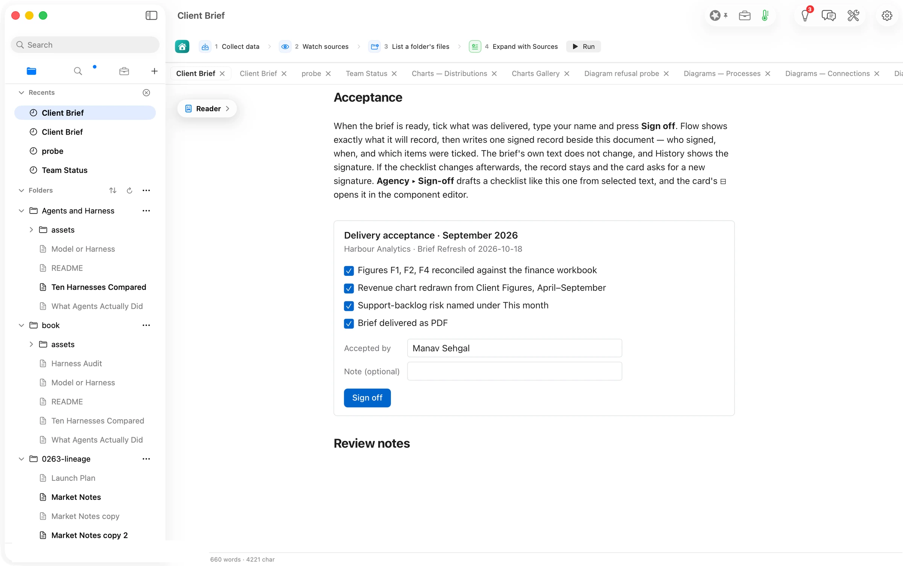
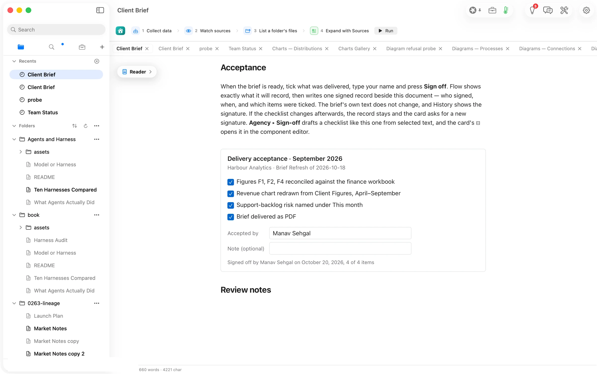
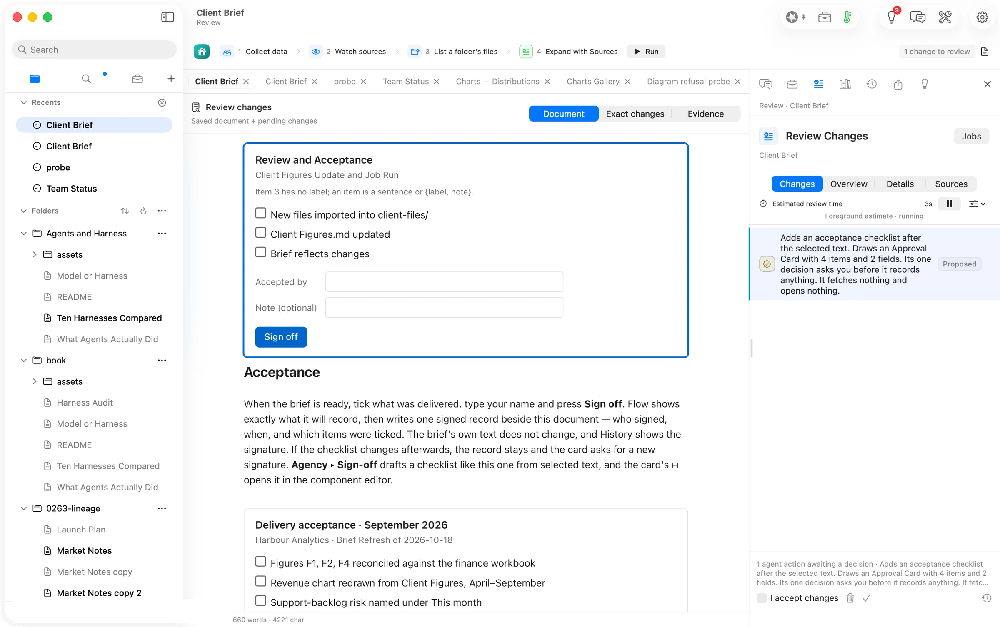
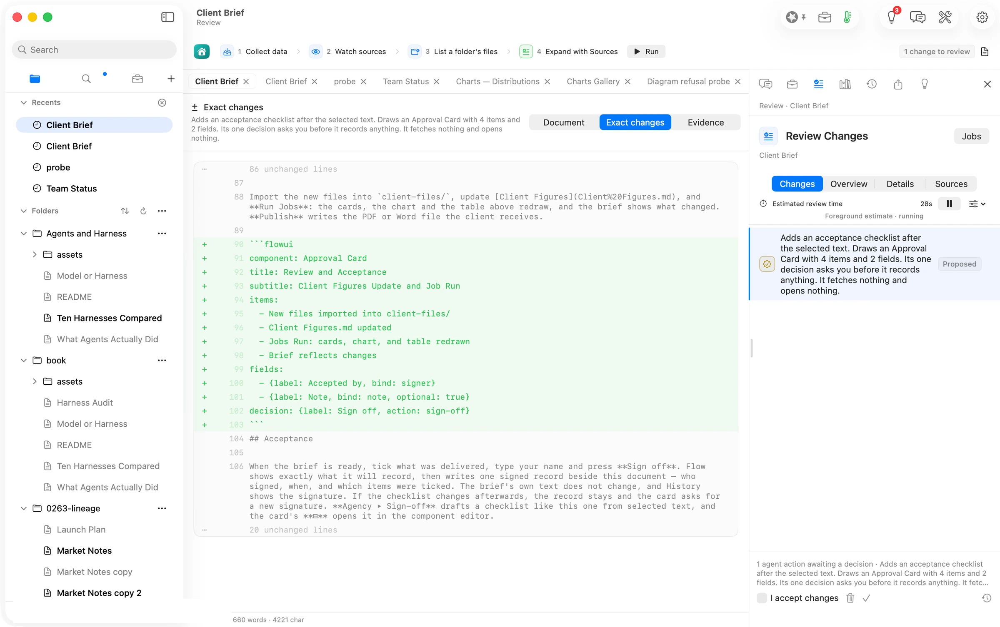
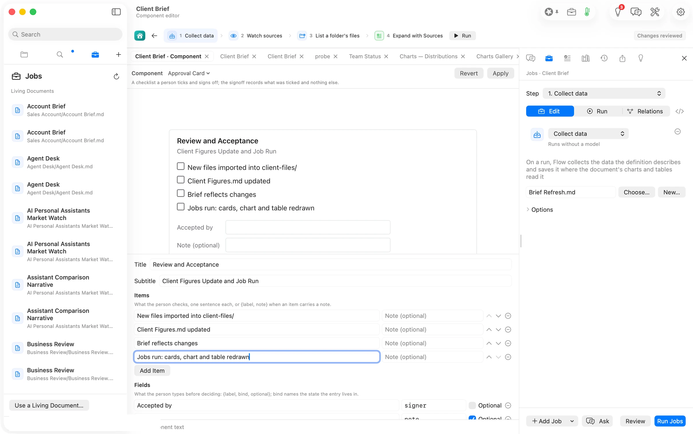
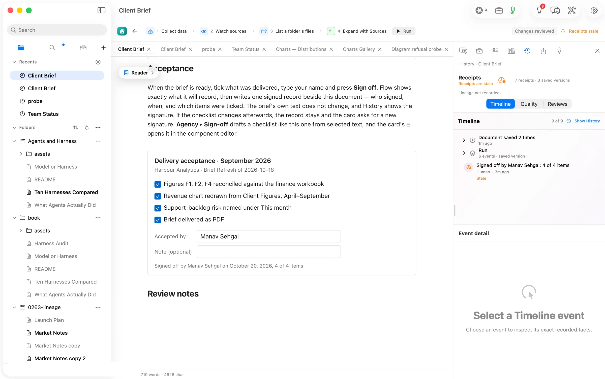
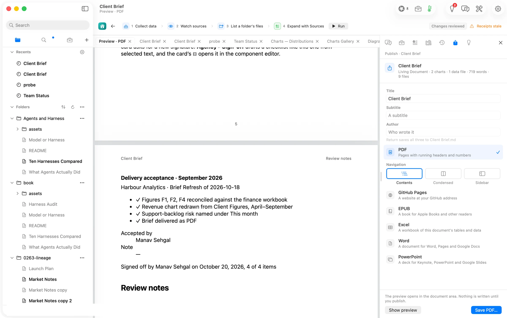

## What Flow does

**A living document can now ask for a signature, and keep it.**
In Orionfold Flow a document can carry an acceptance checklist drawn as a card: the items to tick, who accepts, an optional note, and one **Sign off** button. Before anything is written Flow shows a sheet that lists exactly what it will record, and on **Sign Off** it writes one signed record beside the document, with who signed, when, and which items were ticked. The document's text does not change, History lists the signature, and reopening the document shows the card signed with its ticks. Edit the checklist afterwards and the card asks for a new signature; the old record stays. **Agency ▸ Sign-off** drafts a checklist from any text you select, arriving in Review Changes like every other change, and the card's **⊟** opens the component editor, where you add items and fields without touching the text. Publish prints the card as the reader saw it, ticks and signature included.

## The answer first

1. **Open a document with an acceptance card**, such as the Guide's *Client Brief*, and read it in the Reader. The card sits where its author put it, with its items, an **Accepted by** field and a **Sign off** button.
2. **Tick what was delivered, type your name, press Sign off.** A sheet lists every item with its tick, the name, and the sentence Flow will record. Press **Sign Off**. The card now shows the ticks held, the name, and *Signed off by … on …, 4 of 4 items*; the button is gone.
3. **To draft a checklist from your own words**, select the text that lists the deliverables in the Editor and choose **Agency ▸ Sign-off**. The card arrives in **Review Changes** as an insertion after the selected text; tick **I accept changes** and press **Approve & Save**.
4. **To edit a card**, hover it and press its **⊟**. The component editor draws the card live, with its title, subtitle, items and fields as controls; **Add Item**, type, **Apply**. **Format ▸ Insert Component…** places a fresh card after the caret, and **Edit Component** opens the one under it.
5. **To see the signature later**, open the Workbench's **History** tab; the record is listed with who signed and when. **Publish** prints the card with its ticks and the signed line.

## The job

A consultant sends Harbour Analytics a brief every month, and every month the acceptance lives somewhere else: an email that says "looks good", a thread, a note in a tracker. When a figure is questioned in November nobody can say which version of September's brief was accepted, or what exactly was agreed to. The Guide's *Client Brief* now ends with an Acceptance section: a card listing the four things the brief delivers. The walk signed that card, drafted a second one from the brief's own *Next month* paragraph, edited it, and looked at what History and Publish make of the result.

## Tick, type, sign

The four boxes tick on a click and untick on a second. The name goes into **Accepted by**; the note is optional. Nothing is written yet: the ticks and the name are state the page holds, not text in the document.

**Sign off** opens the sheet. It says in one paragraph where the record goes and that the document's own text does not change, lists each item with its tick and the name, and ends with the sentence that will be recorded. **Cancel** records nothing.

After **Sign Off** the card draws signed: the ticks held, the name, the signed line, no button. Beside the document Flow wrote one record with the same facts. The brief's word count did not move.

## Draft one from the brief's own words

The brief's *Next month* paragraph lists what the next refresh delivers. Selected in the Editor, **Agency ▸ Sign-off** turned it into a card in a few seconds on the Mac's own model, and the proposal landed in **Review Changes** like any other change, with a sentence saying what it does: it adds a checklist after the selected text, draws one card, and its one decision asks before it records anything. The model wrote one item with a colon in it, and the card says so in a line of its own rather than guessing; until a drafted item with a colon is read as a sentence, type it again in the component editor or put it in quotes.

**Exact changes** shows what will be written: a block of plain text inside the document. That is the whole mechanism. The card is Flow's own small language in the chart fence's dialect, readable in any editor, and the signature is a record beside the file, never a change to it. **I accept changes**, then **Approve & Save**.

## Edit it without touching the text

The card's **⊟** opens the component editor on the drafted block. The card is drawn live at the top; beneath it the title, subtitle, items and fields are controls. **Add Item** adds a row; the fourth item typed here, colon and all, is written correctly. **Apply** saves the document and returns to it. A signed card opens read-only with its signed caption; editing its text starts a new version, and the earlier record stays in History.

## What History and Publish make of it

The Workbench's **History** tab lists the signature as its own event, with the attester *Human* and the time, next to the document's saves and the drafting run. Once the document has been saved again after the signature the row carries the word *Stale*, which here means only that the document moved on; the card itself stays signed as long as its own text is unchanged.

**Publish** prints the card as the reader saw it: the items with their ticks, the name, the signed line. PDF and EPUB print it this way; Word and PowerPoint carry the checklist as its text for now.

## The numbers

| Figure | Value | Status · source |
| --- | --- | --- |
| Items on the Guide's card; items ticked and recorded | 4; 4 of 4 | verified · the sheet and the record read back |
| Records written by one signature | 1 | verified · the companion file beside *Client Brief.md* holds one signoff record after Sign Off |
| Change to the document's text on signing | none | verified · the file's bytes before and after the signature are the same |
| Time from **Agency ▸ Sign-off** to the proposal on screen | 6 s on the repeat; first timing unresolved | verified for the repeat · 09:52:46–09:52:52; the first walk’s “about 15 s” conflicts with its 09:32:12–09:32:45 timestamps |
| Model and route for the draft | the Mac's own model, Flow Runtime, gemma-4-e4b 4-bit | verified · the run's receipt |
| Tokens for the draft | 646 in, 115 out | verified · the run's receipt |
| Cost of the walk | $0.00 | verified · no hosted route was used; the day's spend journal |
| Items drafted; items drawn | 4; 3, one named as unreadable | verified · the card in Review Changes and the exact change |
| Pages in the published brief | 6 | verified · the PDF preview's page numbers |

## More Flow walks

- [One brief, three ways](/flow/paths/the-canvas/)
- [Diagrams that draw anywhere](/flow/paths/diagrams-draw-anywhere/)
