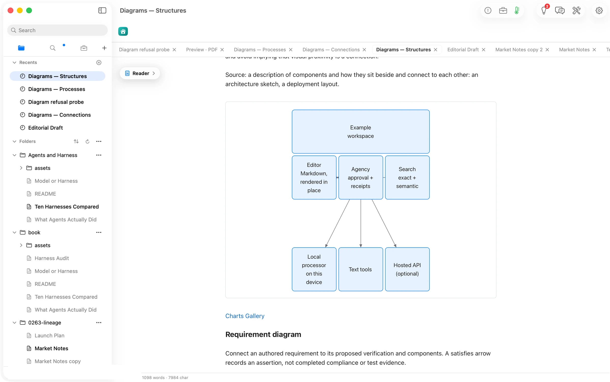
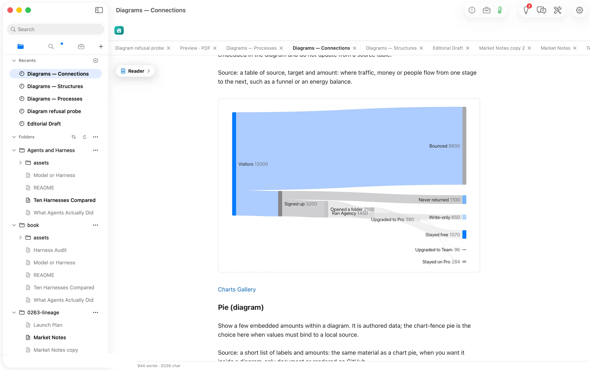
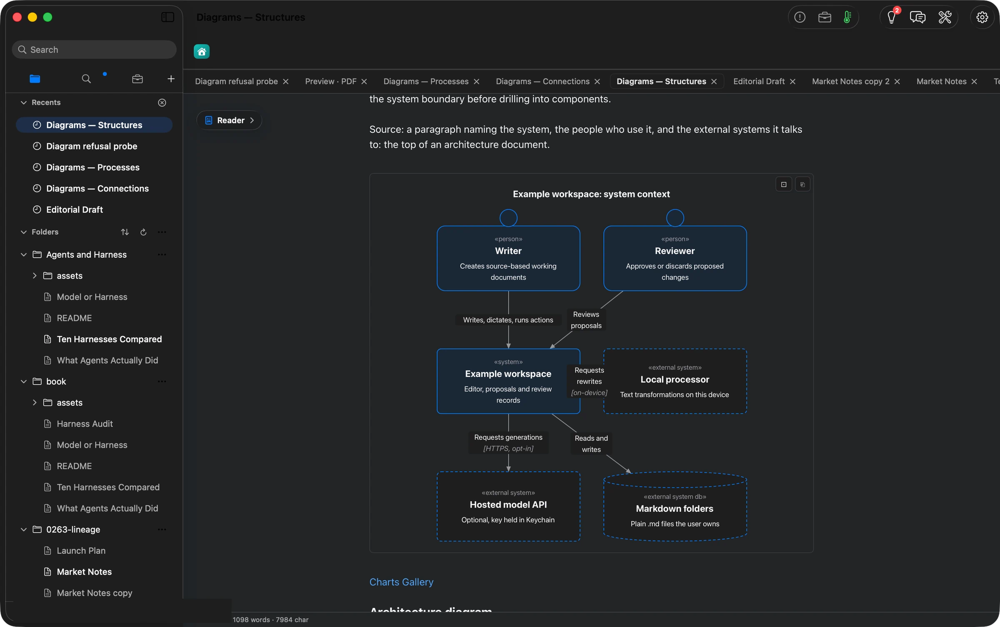
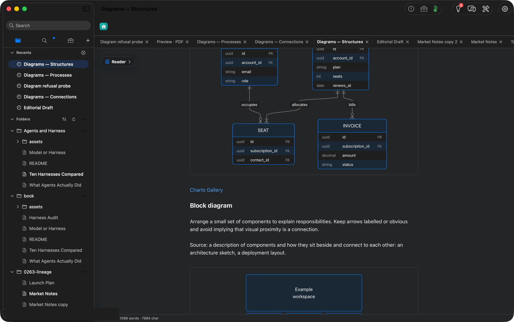
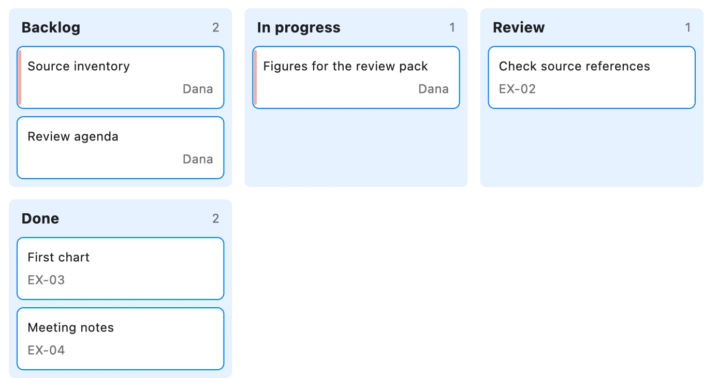
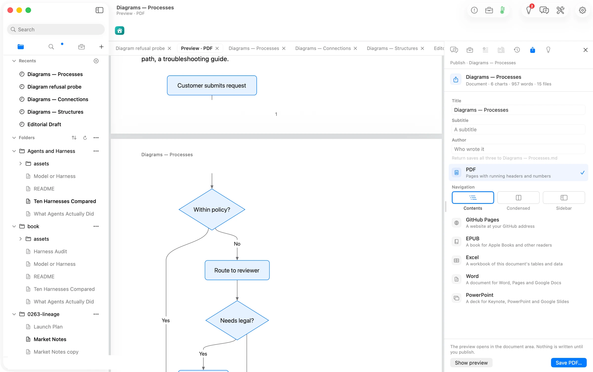
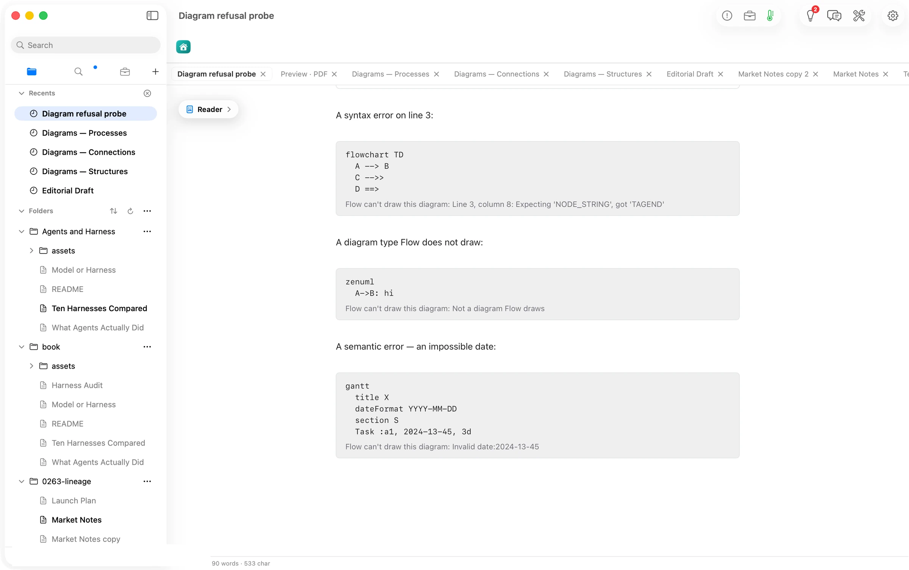

## What Flow does

**A diagram is text, and text goes everywhere. Now the drawing does too.**
In Orionfold Flow a diagram is a fenced block of plain text in the document, a flowchart, a sequence, a Gantt, a state machine, a C4 context, twenty forms in all, in the Mermaid syntax that GitHub and most Markdown tools already read. Flow draws it in place as you read. The same drawing appears in dark mode without redrawing, copies to the clipboard as a picture with the document's own colours, comes out in the published PDF, and is drawn and checked overnight by the document's Jobs, on this Mac, with no window open. A diagram that cannot draw says so on its card, with the line and column, instead of leaving a blank.

## The answer first

1. **Write the diagram as text.** In the Editor, a fenced block beginning ` ```mermaid ` holds the diagram: `flowchart LR`, `sequenceDiagram`, `gantt`, `stateDiagram-v2`, `C4Context` and the rest. The Guide's **Charts Gallery** pages show every form with a starter you can copy.
2. **Read it.** Switch to **Reader**: the diagram draws in place, laid out for the width of the page. A drawing wider than the page keeps its words readable and scrolls sideways inside its card.
3. **Copy it as a picture.** Hover the drawing and press **Copy as image**: a PNG with the document's colours is on the clipboard for Keynote, Slack or mail.
4. **Publish it.** File ▸ **Publish…**, then **Show preview**: the PDF pages carry the same drawings. Save PDF, EPUB or Word when you are ready.
5. **Let Jobs draw it overnight.** A **Visualize** step in the document's Jobs now draws and checks its diagram with nothing open; a broken one is refused before it reaches **Review Changes**, with the line that is wrong.

## The job

A writer explaining how a request moves through approval, how four systems talk, or when a launch lands reaches for a diagram. In Flow the diagram has always been text in the document, so it versions, searches and travels with the words. What it could not do until now was leave the window: the drawing existed only while the document was open on screen, so the overnight Jobs that keep a living document current could draw a chart but had to leave a diagram for the morning, and a published page or a copied picture depended on what the page happened to have drawn. The renderer underneath the fence has changed; the text has not. Every diagram you already have draws as it did, laid out a little better for the page it sits in.

## In the Reader: twenty forms, laid out for the page



The three *Diagrams* pages of the Guide carry twenty forms between them, class, entity-relationship, block, requirement, C4 context, architecture, packet; flowchart, sequence, state, Gantt, user journey, kanban; mindmap, timeline, quadrant, sankey, pie, XY chart, git graph. Every one drew. A drawing is laid out for the width it is read in, so the C4 context that used to be drawn at a third of its size now spreads to the column with its labels the same size as the prose. The two forms that are wider than any page, the packet header at 1,035 px and the user journey at 1,276, keep their words at a readable size and scroll sideways in their card, with the same thin bar a wide table shows.



Two things a careful eye will notice: on the sankey, two short nodes that share a column have labels that touch, and on the quadrant chart one label straddles the line between quadrants. Both are the renderer's layout and both are reported upstream; neither hides a word.

## In the dark



Switch the Mac to dark and the drawings follow without being redrawn. The renderer colours only through the document's own palette, the ink, the soft ink, the accent, the canvas, so a diagram wears the same colours as the prose around it in either appearance.



## On the clipboard



Hover any drawing and press **Copy as image**. The picture on the clipboard is the drawing with its colours carried along: paste it into a deck or a message and it looks as it did on the page, on a white surface.

## In the PDF



File ▸ **Publish…** and **Show preview**. The PDF pages carry every drawing the Reader showed, as vector art, with a figure kept whole on its page. The preview is the same bytes the saved file will hold; nothing is written until you press **Save PDF…**.

## When a line is wrong



A diagram that cannot draw keeps its text on the card and adds one line in the renderer's own words: *Flow can't draw this diagram: Line 3, column 8: Expecting 'NODE_STRING', got 'TAGEND'*. A form Flow does not draw says *Not a diagram Flow draws*; an impossible date in a Gantt says *Invalid date:2024-13-45*. The same words are what a Jobs step reports when an overnight proposal carries a broken diagram, so the morning's review never opens on a card that cannot draw.

## Overnight

The document's Jobs can draw a diagram with nothing open. A **Visualize** step that proposes a diagram is drawn and checked in the night's own renderer, exactly as a chart is, and a proposal that does not draw is refused with its line and column before it reaches Review Changes. The step's description in the Jobs editor now reads *Visualization proposal · drawn, then your review*, because that is all it does.

## The numbers

| Figure | Value | Status | Source |
|---|---|---|---|
| Diagram forms drawn on the Guide's three pages | 20 of 20 (7 + 7 + 6 renders, 0 errors) | verified | the page's render counter, read after each page was scrolled |
| Shipped diagram fences that draw with no window | 46 of 46 | verified | the gallery's 20 and the Guide's 26 rendered in Node and in JavaScriptCore |
| Time to draw one diagram | 0.11–5.88 ms in Node; at most 6 ms in JavaScriptCore | verified | measured over the 46 fences |
| Diagrams that re-lay out for the column | 19 of 46 | verified | rendered at a 688 px width and compared with their natural size |
| C4 context, natural width | 1,180 → 484 px at a 688 px column | verified | the drawing's reported size |
| Size the app's rendering bundles lost | 2.1 MB (6.08 MB against 8.19 MB) | verified | the two app bundles' resource files, byte counts |
| Copied picture | 1360 × 732 PNG for a 680 px card | verified | the pasteboard, read back to a file |
| Time a reader waits for a diagram to appear |, | unknown | not timed; the Reader schedules a render 300 ms after the text settles |
| Overnight run drawing a diagram |, | verified in the suite, not in a live night | the night renderer's tests pass; no overnight run was made this day |
| PDF, EPUB and Word files saved |, | not done | the PDF preview was read; no file was saved in this walk |

## More Flow walks

- [One brief, three ways](/flow/paths/the-canvas/)
- [A checklist you can sign, inside the document](/flow/paths/a-checklist-you-can-sign/)
