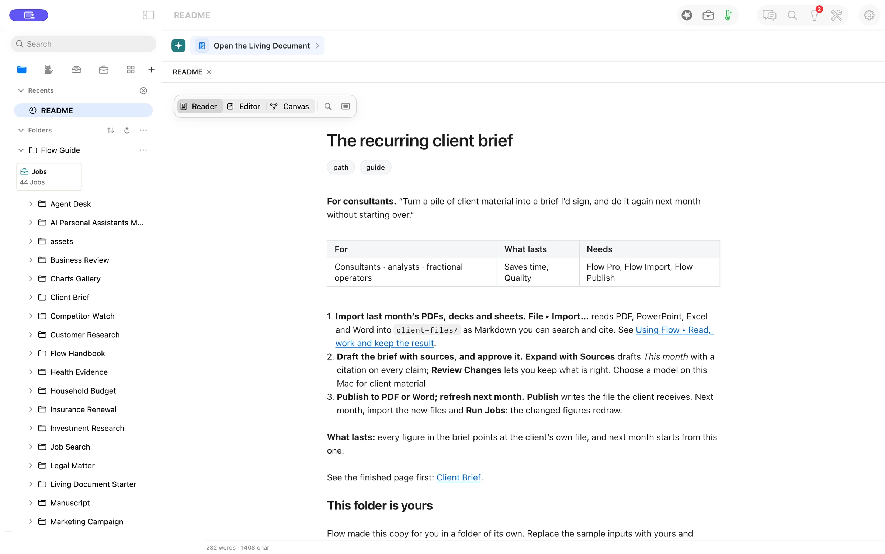

**Starting a job and coming back to it now have their own places.** Welcome helps you get set up. Paths gives you worked examples to open as editable copies. The sidebar holds the things you’ll come back to, including folders, your Folds, reviews and Jobs.

> “I need a place to start on Monday and a way back to the same work on Tuesday.”
> *Illustrative scenario.*

## Open your first path

1. Press **New** above the document to open **Welcome** and **Paths**.
2. Search for a path or narrow the list with a category such as **Clients**. Open **The recurring client brief** to make a copy.
3. Read the steps in its README. Use **Open the Living Document** to see the worked brief. When you need another example, press **New** again.

## A client brief you can make your own

A recurring brief needs a place for the source files, a way to review what changed, and a document you can send. The sample README lays those steps out and links to a finished example. Edit your copy as you go. The Guide keeps the original.

Use **Folders** to find the copy again, **Folds** for your personal Fold and Playbook Folds, **Your turn** for decisions, and **Jobs** for saved work that can run. The **Workbench** opens beside a document when you want its own Review, History, or Jobs.

## Evidence

| What we checked | Result |
| --- | --- |
| Opening the example | Verified. Flow opened a separate copy of the README. |
| Model cost | Verified. No model was called to open the path. |
