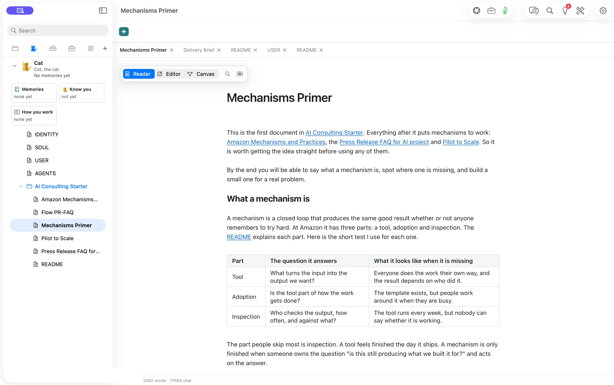

**A Flow Playbook lets someone use your method from a folder they can work in.** Share the brief, checklists and examples together. Readers can bring the folder into Flow and choose which upstream changes to apply on later updates.

> “I’ve improved the kickoff checklist. My team should be able to take that update and keep working in their own copy.”
> *Illustrative scenario.*

## Open a published Playbook

1. In Flow, choose **File ▸ New from GitHub…**. Paste the public folder address and press **Read Folder**.
2. Read the file count, version and license in the preview. Choose where to put the copy, then press **Add**. Flow opens the README.
3. Use **Check for Updates…** later to inspect upstream changes. Select the files you want and press **Update Selected**.

Try the [AI Consulting Starter on GitHub](https://github.com/orionfold/flow/tree/main/flow-playbooks/ai-consulting-starter). To see how a full Playbook is made from an empty folder, read [how AI Consulting was built in Flow](/playbooks/ai-consulting/).

## Read the method where you’ll use it

The starter includes an explanation of working backwards, a mechanisms primer, and material for taking an AI pilot to scale. Once added, the files are available in the sidebar. The **Mechanisms Primer** opens as a document you can read in place.

To share your own method, choose **Publish Folder… ▸ GitHub Repository**. Confirm the destination and the files before publishing. Keep personal preferences in your personal Fold and put the reusable method in the Playbook folder you intend to share.

## Evidence

| What we checked | Result |
| --- | --- |
| Import preview | Verified. Six files, about 75 KB, and a CC BY 4.0 license appeared before Add. |
| Imported files | Verified. All six Markdown files matched the published files byte for byte. |
| Model cost | Verified. The public import called no model. |
| Publisher and selected updates | Verified in a separate release review. The shots show the public reader import. |
